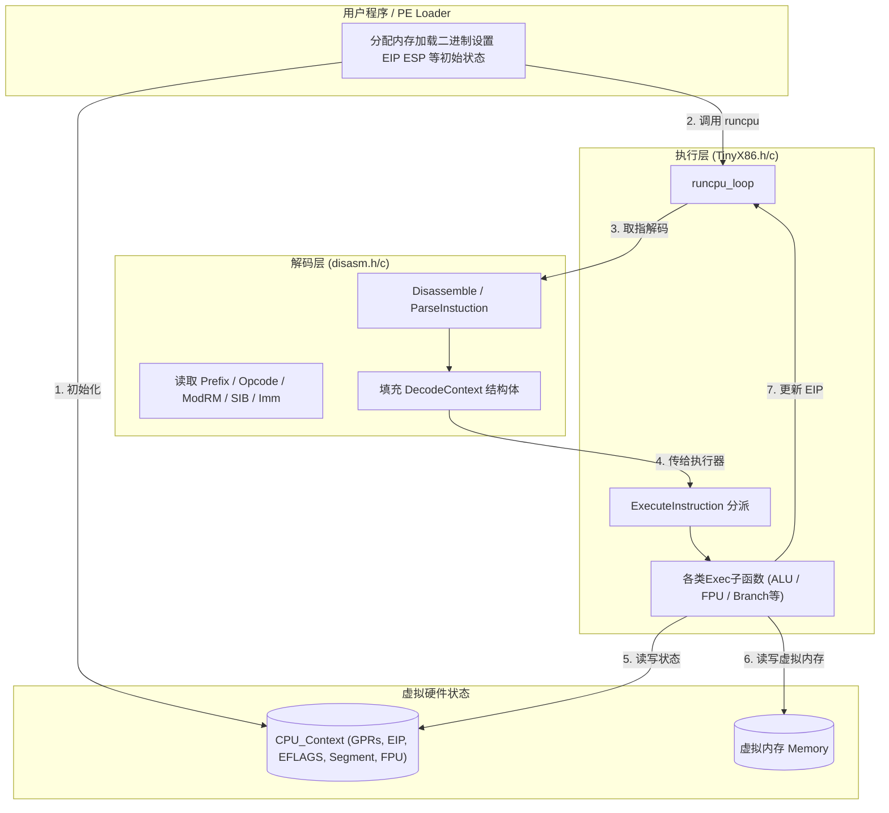
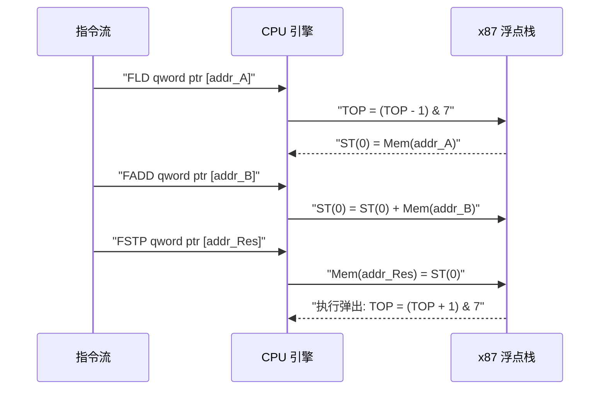

# [原创] C语言实现x86 CPU模拟器：TinyX86的敏捷开发记录

## 引言

在底层安全和逆向分析的学习过程中，直接编写一个 CPU 模拟器是理解指令集架构最直接的方式。为了深入理解 x86 架构的指令执行逻辑、标志位变化以及 FPU 浮点栈的工作原理，我使用纯 C 语言编写了一个轻量级的 x86-32 CPU 模拟器 —— **TinyX86**。

本项目并非完全从零开始，它的**指令解码部分继承自我之前编写的反汇编引擎项目**。在已有反汇编引擎的基础上，本项目重点投入在“指令执行”和“CPU状态维护”上。

开发过程采用了敏捷开发模式，将整个 x86 架构的模拟工作拆分成了 13 个 Sprint（迭代版本）。本文将以 Sprint 迭代为线索，分享这个模拟器是如何从只能执行简单加减法，逐步演进为支持 PE 文件加载、带交互式调试器以及 FPU 浮点运算的完整工程。

---

## 0. 系统宏观架构：解码与执行的彻底分离

在架构设计上，TinyX86 严格区分了**解码层（Decode）**与**执行层（Execute）**。解码层复用了我之前的反汇编引擎代码，负责将机器码解析为统一的 `DecodeContext` 结构体，而执行层根据上下文更新 CPU 寄存器和内存。



### 核心数据结构：CPU Context

CPU 的状态封装在 `CPU_Context` 中。为了直接映射 x86 寄存器的物理重叠特性（如 EAX 与 AX、AL、AH 的关系），代码大量使用了 C 语言的 `union` 和位域（Bit-field）。

```c
typedef struct {
    // 通用寄存器
    union {
        REG32 GPR[8];
        struct { REG32 EAX; REG32 ECX; REG32 EDX; REG32 EBX; REG32 ESP; REG32 EBP; REG32 ESI; REG32 EDI; };
    };
    DWORD EIP; // 指令指针
    
    // EFLAGS 位域定义
    union {
        DWORD Value;           
        struct {               
            DWORD CF : 1; DWORD : 1; DWORD PF : 1; DWORD : 1;
            DWORD AF : 1; DWORD : 1; DWORD ZF : 1; DWORD SF : 1;
            DWORD TF : 1; DWORD IF : 1; DWORD DF : 1; DWORD OF : 1;
            // ... 省略部分保留位
        };
    } EFLAGS;
    
    // 省略段寄存器及 FPU 上下文
} CPU_Context;
```

---

## 敏捷开发记录

### Sprint 1-3：ALU与标志位管理

这个阶段的核心是实现通用 ALU（算术逻辑单元）引擎。难点不在于数值计算，而在于**正确跟进 EFLAGS 标志位的变化**。
每次运算都会影响 ZF(零)、CF(进位)、SF(符号)、OF(溢出) 等标志。我将其抽象为 `UpdateEFLAGS` 函数，统一处理：

```c
// 统一的 EFLAGS 更新逻辑
void UpdateEFLAGS(CPU_Context* ctx, uint32_t res, uint32_t dest, uint32_t src, int size, ALU_Op op) {
    // ZF, SF 是通用的判断
    ctx->EFLAGS.ZF = (res == 0);
    ctx->EFLAGS.SF = (res >> (size - 1)) & 1;
    ctx->EFLAGS.PF = CalcPF((uint8_t)res);

    if (op == ALU_ADD || op == ALU_ADC) {
        // 无符号进位
        ctx->EFLAGS.CF = (res < dest) ? 1 : 0;
        // 有符号溢出
        ctx->EFLAGS.OF = ((dest ^ res) & (src ^ res) & sign_mask) ? 1 : 0;
    }
    // ... 其它指令的独立逻辑
}
```

### Sprint 4-6：控制流、栈与内存读写

接下来的迭代重点完善指令的执行能力：
1. **栈操作**: 实现 `PUSH` / `POP`，维护 ESP 寄存器。
2. **内存读写与 Group扩展**: 实现移位操作、乘除法。依靠前期的解码器遗产 `GetEffectiveAddress` 快速处理 ModR/M 和 SIB 寻址。
3. **控制流跳转**: 实现条件跳转 (`Jcc`)、`JMP`、`CALL`、`RET`。

其中，条件跳转（如 `JE`, `JB`, `JG` 机器码 `0x70`-`0x7F`）的低 4 位直接编码了触发条件。通过提取指令 opcode 低 4 位，可以很优雅地判断条件：

```c
bool CheckCondition(CPU_Context* ctx, uint8_t condition_code) {
    bool CF = ctx->EFLAGS.CF; bool ZF = ctx->EFLAGS.ZF;
    bool SF = ctx->EFLAGS.SF; bool OF = ctx->EFLAGS.OF;

    switch (condition_code & 0x0F) { // 取低4位
        case 0x0: return OF;            // JO
        case 0x1: return !OF;           // JNO
        case 0x2: return CF;            // JB/JC/JNAE
        case 0x4: return ZF;            // JE/JZ
        case 0xC: return (SF != OF);    // JL/JNGE
        case 0xF: return !ZF && (SF == OF); // JG/JNLE
        // ... 其他条件
    }
}
```

### Sprint 7-10：串操作与系统级模拟

这一阶段主要攻克复杂指令：
- **复杂栈帧**: `ENTER` / `LEAVE`。
- **串操作**: `MOVSB/D`, `STOSB/D` 及 `REP` 前缀的组合。需要精确控制 `ESI` / `EDI` 和方向标志 `DF`。
- **软件中断机制**: 实现 `INT n` 和软断点 `INT 3`。通过高层模拟 (HLE) 拦截 `INT 21h` (AH=09h)，使得汇编代码可以直接调用宿主机的 `printf` 打印控制台输出。

### Sprint 11：x87 FPU 浮点子系统

开发 FPU 是工程量最大的一次迭代。x87 FPU 使用包含 8 个寄存器的**环形数据栈（Register Stack）**，由 `Status Word` 中的 `TOP` 字段指示当前栈顶。



在 C 语言实现中，我使用 `double` 数组模拟了 8 个物理寄存器，通过宏定义完成物理索引与逻辑栈 `ST(i)` 的映射：

```c
// 物理索引 = (TOP + i) % 8，TOP 向下增长
#define ST(i) ctx->FPU.Regs[(ctx->FPU.SW.TOP + (i)) & 0x7]
```

### Sprint 12-13：PE加载器与交互式调试器

为了让模拟器具有实用性，我在后期的 Sprint 中加入了周边生态：
1. **PELoader**: 集成 PE 头部解析（基于前期积累的 PETools 工具），通过 `VirtualAlloc` 将 Windows EXE 映射进模拟器进程，并处理了 ImageBase 地址的问题。
2. **命令行 Debugger**: 实现了一个类似于 GDB/OD 的交互式调试终端：
   - 步入 (`s`)、步过 (`n`)、继续运行 (`c`)。
   - 断点设置 (`bp`)。
   - 实时解析反汇编并打印寄存器与堆栈（如 `stack 10` 命令）。

### 测试验证 (GTest)

为确保执行的绝对准确，尤其是边界条件下的标志位变更，我引入了 **Google Test (GTest)** 框架，对所有单元指令（ALU、移位、FPU等）编写了大量测试用例。这也在敏捷迭代中起到了回归防报错的关键作用。

## 总结

目前 TinyX86 代码量约为几千行，基于前期拆解的反汇编引擎构建出了解释执行的逻辑网络，能够稳定运行携带复杂浮点逻辑和常规 Windows 断点逻辑的二进制文件。

项目结构划分清晰，后续若需实现 MMU 面向分页内存的模拟，或者尝试引入 JIT 技术提高解释效率，底层框架都具备了足够的扩展性。完整的源码提交细节和实现均可在 GitHub 上的提交历史中查阅，供大家参考交流。
