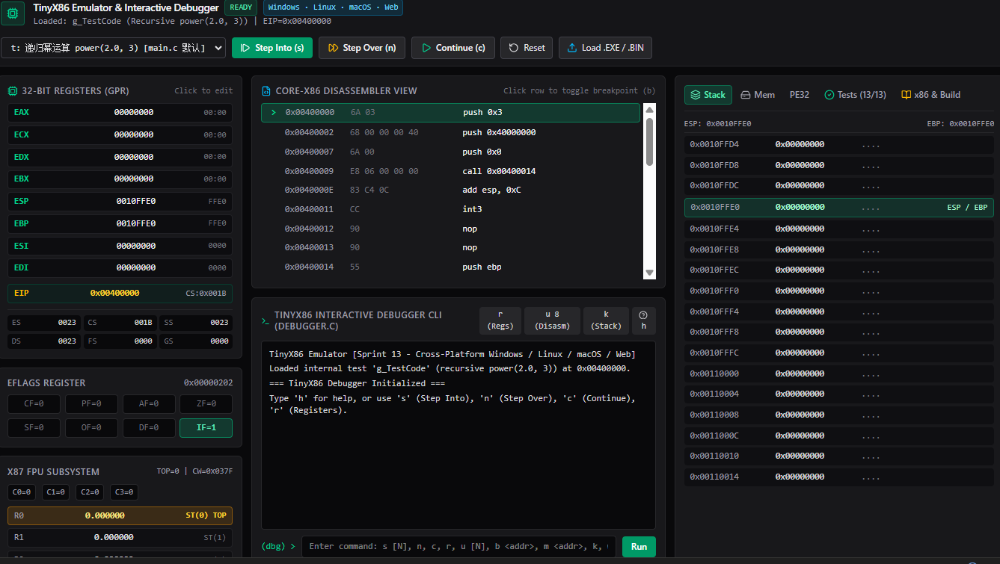
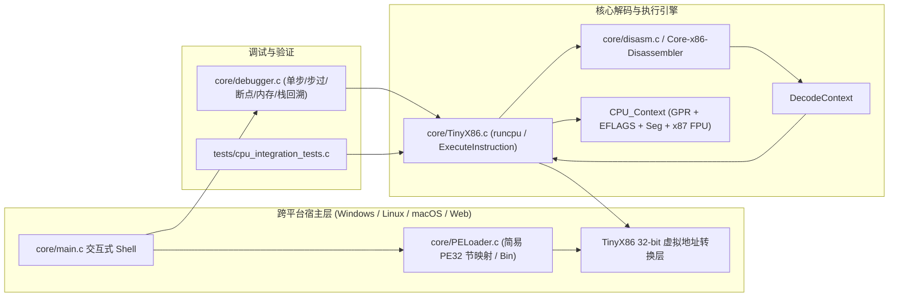

# TinyX86 —— 为深入理解 x86 汇编而生的轻量级 CPU 模拟器与交互式调试器

[](#6-跨平台构建指南windows--linux--macos--web)
[](#3-目录结构与系统架构)
[](#4-已实现的-x86--x87-指令集全景)

> **“What I cannot create, I do not understand.” —— Richard Feynman**
>
> 在逆向工程（滴水逆向）与底层系统安全的学习过程中，“看懂反汇编代码”只是第一步；唯有亲手用纯 C 语言把取指（Fetch）、解码（Decode）、寻址（Effective Address）、算术逻辑单元（ALU）、标志位演化（EFLAGS）、硬件栈帧（Stack Frame）以及 x87 浮点环形栈（FPU Stack）完整实现一遍，才能真正从底层逻辑的视角吃透 x86 汇编。

**TinyX86** 是一个用于学习目的、采用纯 C11 编写的轻量级 **x86-32 CPU 与 x87 FPU 指令集模拟器**，配套 **简易 PE32 入口点 / 原始机器码加载器** 与 **类 GDB/OllyDbg 命令行交互式调试器**，并同时提供 **Web 在线可视化调试工作台**。现已支持 **Windows (x86 / x64)**、**Linux (x86_64 / ARM64)** 与 **macOS (Intel / Apple Silicon)** 跨平台构建与运行。

### Web 可视化调试工作台实际运行界面



> **上图：TinyX86 Web 可视化调试器实际运行界面** —— 顶部支持切换内置汇编测试预设、单步步入（`Step Into (s)`）、单步步过（`Step Over (n)`）、继续运行（`Continue (c)`）与加载本地 `.EXE / .BIN`；左侧实时展示 32 位通用寄存器（`EAX~EDI`）、`EIP`、段寄存器、可点击切换的 `EFLAGS` 标志位与 `x87 FPU` 子系统状态；中部为 `Core-x86 Disassembler View` 反汇编视图与兼容 `debugger.c` 的交互式命令行终端；右侧提供 `Stack`（栈帧视图）、`Mem`（内存 Hex 视图）、`PE32`（PE 头基础信息）、`Tests`（13 项内置自检测试）与构建说明标签页。

---

## 目录

1. [项目初心：为什么通过手写模拟器深入学习 x86 汇编？](#1-项目初心为什么通过手写模拟器深入学习-x86-汇编)
2. [手写模拟器能彻底攻克的 6 大 x86 汇编核心难点](#2-手写模拟器能彻底攻克的-6-大-x86-汇编核心难点)
3. [目录结构与系统架构](#3-目录结构与系统架构)
4. [已实现的 x86 / x87 指令集全景](#4-已实现的-x86--x87-指令集全景)
5. [项目能力边界与当前局限性（重要说明）](#5-项目能力边界与当前局限性重要说明)
6. [跨平台构建指南（Windows / Linux / macOS / Web）](#6-跨平台构建指南windows--linux--macos--web)
7. [如何同步更新子模块（如 `Core-x86-Disassembler`）](#7-如何同步更新子模块如-core-x86-disassembler)
8. [交互式调试器（Debugger）命令手册与实战演练](#8-交互式调试器debugger命令手册与实战演练)
9. [自动化测试与验证体系](#9-自动化测试与验证体系)
10. [扩展文档与相关仓库](#10-扩展文档与相关仓库)

---

## 1. 项目初心：为什么通过手写模拟器深入学习 x86 汇编？

在初学 x86 汇编和逆向分析时，我们经常会遇到以下困惑：
- 为什么 `mov al, 0xFF` 不会清空 `EAX` 的高 24 位，而某些操作又会零扩展或符号扩展？
- `CMP` 和 `SUB` 指令到底是怎么设置 `CF`（进位/借位）和 `OF`（有符号溢出）的？为什么 `JL` 看的是 `SF != OF`，而 `JB` 看的是 `CF == 1`？
- 为什么 `INC` 和 `DEC` 指令会修改 `OF`、`SF`、`ZF`、`AF`、`PF`，却偏偏**不修改 `CF` 进位标志**？
- 编译器生成的函数序言 `push ebp; mov ebp, esp; sub esp, 0x40; lea edi, [ebp-0x40]; mov ecx, 0x10; mov eax, 0xCCCCCCCC; rep stosd` 每一步在内存和寄存器里究竟发生了什么？
- x87 浮点指令（`FLD`、`FMUL`、`FSTP`）为什么没有固定寄存器名，而是用 `ST(0)`、`ST(1)` 这种“相对栈顶”的方式寻址？

为了把这些悬在半空的理论彻底落地，本项目采用 **13 个敏捷迭代（Sprint 1 ~ Sprint 13）** 的方式，在复用自研反汇编引擎（[Core-x86-Disassembler](https://github.com/582835293/Core-x86-Disassembler)）和 PE 解析库（[PETools](https://github.com/582835293/PETools)）的基础上，从零实现了 CPU 执行引擎与交互式调试器。

---

## 2. 手写模拟器能彻底攻克的 6 大 x86 汇编核心难点

### 2.1 通用寄存器的物理重叠（Union 位宽映射）
x86 的 32 位通用寄存器（如 `EAX`）向下兼容 16 位（`AX`）与 8 位高低字节（`AH`、`AL`）。在 `include/TinyX86.h` 中，我们利用 C 语言的 `union` 精确复刻了小端序下的硬件寄存器重叠布局：

```c
typedef union {
    uint32_t I32;       // 32位访问: EAX
    uint16_t I16;       // 低16位访问: AX
    struct {
        uint8_t L;      // 低8位访问: AL (bits 0..7)
        uint8_t H;      // 次低8位访问: AH (bits 8..15)
    } I8;
} REG32;
```
此外，在 x86 机器码编码中，8 位寄存器索引 `0~3` 对应 `AL, CL, DL, BL`，而索引 `4~7` 并非对应 `ESP~EDI` 的低 8 位，而是对应 **`AH, CH, DH, BH`**（即 `GPR[reg_index - 4].I8.H`）。亲手实现 `ReadGPR` 与 `WriteGPR` 后，对 ModR/M 字节中的 `reg` 字段编码再也不会混淆。

### 2.2 EFLAGS 标志位的数学本质（CF vs OF vs AF）
x86 硬件加法器实际上并不区分“有符号数”和“无符号数”——同一套补码加减法电路同时更新两套标志位，交由后续的 `Jcc` 条件跳转指令按需解读：

- **CF（Carry Flag，无符号进位/借位）**：
  - 加法 (`ADD`)：`truncated_res < dest`（无符号回绕溢出）。
  - 减法 (`SUB`/`CMP`)：`dest < src`（无符号不够减产生借位）。
- **OF（Overflow Flag，有符号溢出）**：
  - 加法 (`ADD`)：**同号相加得异号**。位运算公式：`((dest ^ res) & (src ^ res) & sign_mask) != 0`。
  - 减法 (`SUB`/`CMP`)：**异号相减结果与被减数异号**。位运算公式：`((dest ^ src) & (dest ^ res) & sign_mask) != 0`。
- **AF（Auxiliary Carry Flag，半进位/BCD 调整标志）**：
  - 利用异或还原无进位加法的性质，直接检测 Bit 4 是否发生进/借位：`((dest ^ src ^ res) & 0x10) != 0`。

### 2.3 ModR/M 与 SIB 复杂寻址公式还原
x86 最灵活也最复杂的内存寻址模式 `[Base + Index * Scale + Disp]` 由 `GetEffectiveAddress` 统一计算：
$$\text{EffectiveAddress} = \text{Base} + \text{Index} \times 2^{\text{Scale}} + \text{Displacement}$$
- 当 `Mod == 00` 且 `R/M == 101 (5)` 时，不读取 `EBP`，而是直接将 32 位 `disp32` 作为绝对地址。
- 当 `R/M == 100 (4)` 时，触发 **SIB（Scale-Index-Base）** 字节解析；若 `Index == 100 (4)`，则表示无变址寄存器（因为 `ESP` 不能作为变址乘数）。
- **`LEA` 与 `MOV` 的本质区别**：`LEA` 完整调用 `GetEffectiveAddress` 计算出有效地址数值后，**不经过 `MemRead` 访存**，直接把地址值写回目的寄存器——因此常被编译器用来做单周期三操作数算术运算（如 `lea eax, [ebx + ecx*4 + 8]`）。

### 2.4 条件指令族（Jcc / CMOVcc / SETcc）的低 4 位编码规律
无论是短跳转 `0x70~0x7F`、近跳转 `0x0F 0x80~0x8F`、条件传送 `0x0F 0x40~0x4F`（`CMOVcc`）还是条件置位 `0x0F 0x90~0x9F`（`SETcc`），它们的 Opcode **低 4 位（0x0 ~ 0xF）完全共享同一套条件判断表（`CheckCondition`）**：

| 低 4 位 | 助记符后缀 | 标志位条件表达式 | 适用场景 |
| :---: | :---: | :---: | --- |
| `0x2` / `0x3` | `B` / `NB` (`AE`) | `CF == 1` / `CF == 0` | 无符号小于 `<` / 无符号大于等于 `>=` |
| `0x4` / `0x5` | `Z` (`E`) / `NZ` (`NE`) | `ZF == 1` / `ZF == 0` | 相等 `==` / 不相等 `!=` |
| `0x6` / `0x7` | `BE` / `A` | `CF \| ZF == 1` / `CF \| ZF == 0` | 无符号 `<=` / 无符号 `>` |
| `0xC` / `0xD` | `L` / `GE` | `SF != OF` / `SF == OF` | **有符号 `<`** / **有符号 `>=`** |
| `0xE` / `0xF` | `LE` / `G` | `ZF == 1 \|\| SF != OF` / `ZF == 0 && SF == OF` | **有符号 `<=`** / **有符号 `>`** |

### 2.5 函数调用栈帧与递归回溯（以内置 `power(2.0, 3)` 为例）
`core/main.c` 内置了 MSVC Debug 模式下编译出的递归函数 `double power(double base, int exp)` 真实机器码（共 83 字节）：
1. **调用者压参（cdecl 约定，从右向左）**：先 `push 3`（`exp`），再分两次 `push 0x40000000` 和 `push 0x00000000`（IEEE-754 双精度浮点数 `2.0` 的高低 32 位）。
2. **保存旧栈底与开辟局部空间**：`push ebp; mov ebp, esp; sub esp, 0x40`。
3. **Debug 栈帧初始化（“烫烫烫”的由来）**：`lea edi, [ebp-0x40]; mov ecx, 0x10; mov eax, 0xCCCCCCCC; rep stosd`——将 64 字节局部变量区全部填充为 `0xCC`（即 `INT 3` 软断点指令 / GBK 编码下的“烫”字）。
4. **递归调用与平栈**：当 `exp > 0` 时递减 `eax` 并再次调用自身 `call 0x00400014`；返回后通过 `add esp, 12` 由调用者平衡栈顶。

### 2.6 x87 FPU 环形寄存器栈（Ring Stack）
不同于 SSE 的平坦寄存器，x87 FPU 将 8 个物理浮点寄存器 `R0 ~ R7` 组织成一个**向下增长的环形栈**，由状态字 `SW.TOP`（3 bit，取值 `0~7`）指向当前栈顶 `ST(0)`：
```c
// 物理索引映射宏：ST(0) 即物理寄存器 Regs[TOP]，ST(i) 即 Regs[(TOP + i) & 7]
#define ST(i) ctx->FPU.Regs[(ctx->FPU.SW.TOP + (i)) & 0x7]
```
- **压栈（`FLD` / `FLD1`）**：`TOP = (TOP - 1) & 7`，再将数值写入新的 `ST(0)`。
- **弹栈（`FSTP` / `FADDP`）**：读取当前 `ST(0)`，随后 `TOP = (TOP + 1) & 7`。
在 `power(2.0, 3)` 递归基（`exp <= 0`）处执行 `fld1` 将 `1.0` 压入 `ST(0)`，随后每一层递归返回前执行 `fmul qword ptr [ebp+8]`，将 `ST(0)` 乘以 `2.0`，最终栈顶 `ST(0)` 精确停留在 `8.0000000000`！

---

## 3. 目录结构与系统架构

项目采用模块化 C 工程目录结构（已移除冗余的 `.vcxproj` / `.slnx` 平台绑定工程文件，统一由 `CMakeLists.txt`、`CMakePresets.json` 与 `Makefile` 驱动）：

```text
TinyX86/
├── include/                      # 核心 C 语言公开头文件 (.h)
│   ├── TinyX86.h                 # CPU_Context、REG32、EFLAGS、FPU 与虚拟内存映射接口
│   ├── disasm.h                  # x86-32 指令解码器结构体 (DecodeContext) 与反汇编接口
│   ├── PELoader.h                # 简易 PE32 节区拉伸 / 原始机器码内存加载接口
│   ├── PETools.h                 # 跨平台 PE32 DOS/NT 头与节表解析结构定义
│   └── debugger.h                # 命令行交互式调试器接口
├── core/                         # 核心 C 语言实现源码 (.c)
│   ├── TinyX86.c                 # CPU 取指-解码-执行主循环、ALU、x87 FPU 与地址转换实现
│   ├── disasm.c                  # 内置跨平台 x86-32 解码器与 Intel 语法格式化实现
│   ├── PELoader.c                # 虚拟内存分配、PE32 节区拷贝与入口点 (OEP) 初始化
│   ├── PETools.c                 # 跨平台 PE32 基础头与节表解析实现
│   ├── debugger.c                # 交互式调试器 (s/n/c/b/r/u/k/m/w/e) 实现
│   └── main.c                    # 命令行交互式 Shell 入口与内置递归测试载荷
├── deps/                         # Git Submodules 外部子模块挂载目录 (可选)
│   ├── Core-x86-Disassembler/    # 独立 x86 反汇编引擎子模块
│   └── PETools/                  # 独立 PE 工具库子模块
├── tests/                        # 自动化测试套件
│   └── cpu_integration_tests.c   # CTest 集成测试 (解码、ALU、栈、分支、x87 FPU)
├── docs/                         # 项目文档与开发笔记
│   ├── images/                   # Web 可视化调试器真实运行截图
│   │   └── web-debugger-screenshot.png
│   ├── architecture.md           # 系统架构、内存模型、执行路径与能力边界
│   ├── project-relationships.md  # 子模块同步更新教程与多仓库协作指南
│   ├── validation.md             # 跨平台编译与测试验证指南
│   └── Kanxue_TinyX86_Blog.md    # 看雪技术长文：13 个敏捷冲刺手写 x86 模拟器全记录
├── src/                          # Web 在线可视化调试工作台 (React + TypeScript + Vite)
├── CMakeLists.txt                # 跨平台 CMake 构建定义
├── CMakePresets.json             # Windows / Linux / macOS 一键构建预设
└── Makefile                      # Linux / macOS / MinGW 极速构建脚本
```



---

## 4. 已实现的 x86 / x87 指令集全景

| 类别 | 已实现指令助记符 | 关键实现细节 |
| --- | --- | --- |
| **数据传送与扩展** | `MOV` (r/m, imm, moffs, seg), `MOVZX`, `MOVSX`, `LEA`, `XCHG`, `NOP`, `CBW`, `CWDE`, `CWD`, `CDQ`, `CMOVcc` (`0F 40~4F`), `SETcc` (`0F 90~9F`), `SAHF`, `LAHF` | 完整支持 8/16/32 位操作数大小前缀（`0x66`）、零扩展与有符号位扩展 |
| **算术与逻辑运算 (ALU)** | `ADD`, `OR`, `ADC`, `SBB`, `AND`, `SUB`, `XOR`, `CMP`, `TEST`, `INC`, `DEC`, `NOT`, `NEG`, `MUL`, `IMUL` (单/双操作数), `DIV`, `IDIV` | 精确维护 `CF`, `PF`, `AF`, `ZF`, `SF`, `OF`；处理 `DIV`/`IDIV` 除零与商溢出保护 |
| **移位与循环移位 (Group 2)** | `ROL`, `ROR`, `RCL`, `RCR`, `SHL` (`SAL`), `SHR`, `SAR` | 支持移位次数 `1`、`CL` 或立即数 `Ib`（掩码 `& 0x1F`），精确计算 `CF` 与单步移位 `OF` |
| **栈与函数栈帧** | `PUSH`, `POP`, `PUSHA` (`PUSHAD`), `POPA` (`POPAD`), `PUSHF`, `POPF`, `ENTER`, `LEAVE` | 支持寄存器、立即数、段寄存器及内存操作数压栈，支持嵌套层级 `ENTER` 栈帧建立 |
| **控制流与循环** | `JMP` (rel8/rel32/r/m32), `Jcc` (short `70~7F` & near `0F 80~8F`), `JCXZ`/`JECXZ`, `CALL` (rel32/r/m32), `RET` (`C3` & `C2 imm16`), `LOOP`, `LOOPE`, `LOOPNE` | 覆盖全部 16 种条件跳转码与平栈返回 `RET n` |
| **串操作指令** | `MOVSB`/`W`/`D`, `CMPSB`/`W`/`D`, `STOSB`/`W`/`D`, `LODSB`/`W`/`D`, `SCASB`/`W`/`D` + `REP` (`F3`) / `REPNE` (`F2`) | 根据 `DF` 方向标志自动增减 `ESI`/`EDI`，支持 `REPE`/`REPNE` 零标志提前终止 |
| **系统与标志控制** | `INT 3` (`CC`), `INT Ib` (`CD`), `HLT`, `CMC`, `CLC`, `STC`, `CLI`, `STI`, `CLD`, `STD` | 极简桩函数拦截 `INT 21h`（`AH=02h` 输出字符、`AH=09h` 输出 `$` 结尾字符串、`AH=4Ch` 退出） |
| **x87 FPU 浮点指令** | `FLD`, `FST`, `FSTP`, `FILD`, `FIST`, `FISTP`, `FLDCW`, `FNSTCW`, `FSTSW`, `FNSTSW AX`, `FADD`/`P`, `FMUL`/`P`, `FSUB`/`R`/`P`, `FDIV`/`R`/`P`, `FIADD`, `FIMUL`, `FISUB`/`R`, `FIDIV`/`R`, `FCOM`/`P`/`PP`, `FUCOMPP`, `FCHS`, `FABS`, `FLD1`, `FLDZ`, `FLDPI`, `FLDL2T`, `FLDL2E`, `FLDLG2`, `FLDLN2`, `FCLEX`, `FINIT` | 环形栈 `TOP` 指针自动回绕，完整支持 `C0/C1/C2/C3` 浮点比较条件码与 `FNSTSW AX` + `SAHF` 经典浮点跳转配合 |

---

## 5. 项目能力边界与当前局限性（重要说明）

**TinyX86 的定位是“面向 x86 汇编与逆向工程初学者的指令级教学模拟器”**，而非完整模拟操作系统环境的商业虚拟机（如 QEMU 或 Unicorn Engine）。为了便于读者准确评估本项目的适用范围，现将当前已实现能力与未实现边界坦诚说明如下：

| 维度 | ✅ 已实现能力 (Implemented) | ❌ 未实现 / 不在当前范围内 (Out of Scope) |
| --- | --- | --- |
| **PE32 加载器 (`PELoader.c`)** | • 解析 `IMAGE_DOS_HEADER`、`IMAGE_NT_HEADERS32` 与节表（`IMAGE_SECTION_HEADER`）<br>• 按 `ImageBase + VirtualAddress` 将各节区（`.text`/`.data` 等）拉伸拷贝到虚拟内存<br>• 分配 64KB 虚拟栈空间并将 `EIP` 指向入口点 `ImageBase + AddressOfEntryPoint` | • **未实现导入表（IAT）与导出表（EAT）解析**<br>• **未实现基址重定位表（`.reloc`）修复**（若指定 `ImageBase` 不可用，仅回退分配地址但不会修正硬编码绝对地址）<br>• 未实现 TLS 回调表（TLS Callbacks）、延迟加载与资源表解析 |
| **操作系统 API 与系统调用** | • 仅在 `Execute_INT` 中通过极简高层模拟（HLE）拦截了 **DOS `INT 21h`** 的 3 个基础子功能：`AH=02h`（打印单字符）、`AH=09h`（打印 `$` 结尾字符串）、`AH=4Ch`（设置 `Halted = 1` 正常退出）<br>• 支持 `INT 3` (`0xCC`) 软断点拦截 | • **不支持任何 Windows Win32 API 或外部 DLL 动态链接**（如 `kernel32.dll`、`user32.dll`、`msvcrt.dll` 等）<br>• **不能直接运行包含标准 C 运行库（CRT 启动代码）的常规编译 `.exe`**（因为 CRT 初始化阶段会调用大量 `GetVersionEx`、`GetCommandLineA`、`HeapCreate` 等系统 API）；仅支持无外部 API 依赖的纯算法 PE32 程序（如自定义 `-nostdlib` / `/NODEFAULTLIB` 指定入口点）或 `.bin` 原始机器码片段 |
| **CPU 指令集与硬件架构** | • 32 位平坦内存模型（Flat Memory Model）下的常用通用寄存器（`EAX~EDI`）、标志位（`EFLAGS`）与核心算术/逻辑/控制流/栈/串操作指令<br>• x87 FPU 8 寄存器环形栈与常用浮点算术/比较指令 | • **不支持 Ring 0 特权级指令**（如 `LGDT`、`LIDT`、`MOV CR0`、`IN`/`OUT`、`IRET`、`SYSENTER`）<br>• **不支持段描述符表（GDT/LDT）权限检查与页表（Paging / MMU）硬件级地址保护**（段寄存器 `CS/DS/SS/ES/FS/GS` 仅作数值保存）<br>• **不支持 MMX、SSE、AVX 等 SIMD 向量扩展指令集**及 64 位（x86_64）长模式指令 |

---

## 6. 跨平台构建指南（Windows / Linux / macOS / Web）

通过引入 **32 位客户机虚拟地址转换层（`TinyX86_RegisterRegion` / `TinyX86_TranslateAddress`）** 与标准 C11 跨平台 PE32 基础头解析器，TinyX86 摆脱了早期版本对 32 位 Windows 宿主进程地址空间的强耦合，可在 **Linux、macOS、Windows（32 位与 64 位）** 下直接编译运行。

### 6.1 方式一：使用 CMake（推荐，全平台 + Visual Studio / CLion / VS Code 原生支持）

项目根目录提供了标准 `CMakeLists.txt` 与 `CMakePresets.json`（Visual Studio 2022/2026 直接使用“打开本地文件夹”即可自动识别 `CMakePresets.json`，无需 `.vcxproj` 或 `.slnx`）：

```bash
# 1. 克隆仓库（包含子模块）
git clone --recurse-submodules https://github.com/582835293/TinyX86.git
cd TinyX86

# 2. 配置并编译（Linux / macOS / Windows 通用）
cmake -S . -B build -DCMAKE_BUILD_TYPE=Debug
cmake --build build --config Debug --parallel

# 3. 运行 CTest 集成测试套件
ctest --test-dir build -C Debug --output-on-failure

# 4. 启动 TinyX86 交互式终端
./build/bin/TinyX86            # Linux / macOS
.\build\bin\Debug\TinyX86.exe  # Windows MSVC
```

也可以使用 **CMake Presets** 一键构建：
```bash
# Linux
cmake --preset linux-debug && cmake --build --preset linux-debug && ctest --preset linux-debug

# macOS (Intel / Apple Silicon)
cmake --preset macos-debug && cmake --build --preset macos-debug && ctest --preset macos-debug

# Windows (Visual Studio Win32 / x64)
cmake --preset windows-x86-debug && cmake --build --preset windows-x86-debug && ctest --preset windows-x86-debug
```

### 6.2 方式二：使用 GNU Make（Linux / macOS / MinGW 极速编译）

```bash
make            # 编译 TinyX86 主程序与测试程序至 build/make/
make test       # 编译并运行 cpu_integration_tests
make run        # 编译并启动 TinyX86 交互式 Shell
make debug      # 使用 -g -O0 编译调试版本
make release    # 使用 -O3 编译优化版本
make clean      # 清理构建产物
```

### 6.3 方式三：启动 Web 可视化调试工作台（Node.js + Vite）

```bash
npm install
npm run dev
# 浏览器访问 http://localhost:3000 即可使用图形化单步调试、寄存器/EFLAGS 实时修改与 PE32 结构查看器
```

---

## 7. 如何同步更新子模块（如 `Core-x86-Disassembler`）

本仓库通过 `.gitmodules` 关联了上游反汇编引擎仓库 `deps/Core-x86-Disassembler`（以及 `deps/PETools`）。当你更新了 `Core-x86-Disassembler` 仓库的代码并推送到 GitHub 后，只需在 `TinyX86` 根目录下按以下 3 步操作即可同步最新代码：

```bash
# 第一步：初始化子模块（仅首次克隆时未加 --recurse-submodules 需要执行一次）
git submodule update --init --recursive

# 第二步：从 GitHub 拉取 Core-x86-Disassembler 远端默认分支的最新提交
git submodule update --remote --merge deps/Core-x86-Disassembler

# 第三步：将更新后的子模块版本指针记录并推送到 TinyX86 主仓库
git add deps/Core-x86-Disassembler
git commit -m "chore(submodule): sync Core-x86-Disassembler to latest"
git push origin main
```

> **提示**：如果你还希望将 `deps/Core-x86-Disassembler` 中的修改同步到本仓库内置的跨平台回退实现（`include/disasm.h` 与 `core/disasm.c`），或者遇到了子模块目录为空、游离头指针（Detached HEAD）等常见问题，请查阅详细图文级教程 👉 **[《子模块同步更新与多仓库协作指南》(docs/project-relationships.md)](docs/project-relationships.md)**。

---

## 8. 交互式调试器（Debugger）命令手册与实战演练

启动 `TinyX86` 后，首先进入外层 **Shell**：

```text
========== TinyX86 Shell ==========
 [e]xe  <path> : Load PE Executable
 [b]in  <path> : Load Raw Binary
 [t]est        : Run Internal Test (Recursive Power 2.0^3)
 [h]elp        : Show Menu
 [q]uit        : Exit
===================================
```

输入 `t` 加载内置递归幂运算测试代码，自动进入 **Debugger (`(dbg) >`)**：

| 命令 | 格式示例 | 功能说明 |
| --- | --- | --- |
| **`s`** | `s` 或 `s 5` | **Step Into（单步步入）**：执行 1 条或连续执行 `N` 条指令，遇到 `CALL` 会进入子函数内部 |
| **`n`** | `n` | **Step Over（单步步过）**：遇到 `CALL`、`LOOP`、`REP STOSD`、`INT` 等块指令时全速执行至下一条指令地址（若中途触发断点则立即停下） |
| **`c`** | `c` | **Continue（继续运行）**：持续执行直到命中用户断点、`INT 3`（`0xCC`）软断点或 `HLT` 停机 |
| **`b`** | `b 400014` | **Set Breakpoint**：在指定十六进制地址设置硬件断点（最多 16 个） |
| **`bl` / `bc`** | `bl` / `bc` | **List / Clear Breakpoints**：列出所有断点 / 清空所有断点 |
| **`r`** | `r` | **Registers**：打印全部 32 位通用寄存器、段寄存器、`EFLAGS` 激活标志位及 `x87 FPU` 8 个物理/逻辑寄存器状态 |
| **`u`** | `u` 或 `u 15` | **Unassemble（反汇编）**：从当前 `EIP` 向后反汇编 `N` 条指令（显示地址、机器码十六进制字节与汇编助记符） |
| **`k`** | `k` 或 `k 12` | **Stack Dump（栈回溯）**：显示当前 `ESP` 栈顶附近的双字（DWORD）内存、ASCII 视图，并自动标注 `<--- ESP (Top)` 与 `<--- EBP (Frame)` |
| **`m`** | `m 400000` | **Memory Dump**：以 16 字节×4 行 Hex + ASCII 格式转储指定地址内存 |
| **`w`** | `w EAX 2A` / `w ZF 1` | **Write Register/Flag**：动态修改任意通用寄存器（`EAX`、`AX`、`AL` 等）、段寄存器、标志位（`CF`、`ZF`、`SF`、`OF`）或 FPU `TOP` |
| **`e` / `ew` / `ed`** | `e 400000 90 CC` | **Edit Memory**：向指定内存地址写入字节流（`e`）、16 位字（`ew`）或 32 位双字（`ed`） |
| **`q`** | `q` | 退出当前调试会话并返回外层 Shell |

### 实战调试 `power(2.0, 3)` 完整流程示例

```text
(Shell) > t
[Shell] Loading internal test...
[Loader] Test code mapped at 0x00400000

=== TinyX86 Debugger Initialized ===
(0x00400000)  push 0x3                        ; Next
(dbg) > u 10
Disassembly (10 lines):
  0x00400000: 6A03             | push 0x3
  0x00400002: 6800000040       | push 0x40000000
  0x00400007: 6A00             | push 0x0
  0x00400009: E806000000       | call +6
  0x0040000E: 83C40C           | add esp, 0xC
  0x00400011: CC               | int3
  ...
(dbg) > c
Running...
[Debugger] Hit Software Breakpoint (INT 3) at 0x00400011
(dbg) > r
--- FPU ---------------------------------------------------------
FPU SW: TOP=7  C3=0 C2=0 C1=0 C0=0
   Reg |      Double Value      | Logical ST(i)
   ----+------------------------+--------------
   R7  |           8.0000000000 | <- ST(0) TOP
```

---

## 9. 自动化测试与验证体系

项目包含 `tests/cpu_integration_tests.c`，直接调用解码器与 `runcpu` 验证：
1. **指令长度与立即数解码验证**：验证 `ParseInstuction` 解码 `mov eax, 40` 等指令的精确字节长度。
2. **ALU、栈与标志位联动验证**：连续执行 `MOV`、`ADD`、`PUSH`、`POP`、`XOR`、`CMP`，断言 `EAX == 42`、`EBX == 42`、`ECX == 0`、`ZF == 1` 且 `ESP` 栈平衡。
3. **相对分支跳转验证**：执行 `JMP rel8` 跳过中间指令，验证目标 `EIP` 与寄存器状态。
4. **x87 FPU 浮点栈运算验证**：连续执行 `FLD1`、`FLD1`、`FADDP ST(1), ST(0)`，验证 `TOP` 指针移动与栈顶结果 `2.0`。

---

## 10. 扩展文档与相关仓库

- [系统架构、内存模型、执行路径与能力边界](docs/architecture.md)
- [子模块同步更新教程与四个关联仓库的依赖管理](docs/project-relationships.md)
- [看雪技术长文：C 语言实现 x86 CPU 模拟器 TinyX86 的敏捷开发记录](docs/Kanxue_TinyX86_Blog.md)
- [构建与测试验证记录](docs/validation.md)
