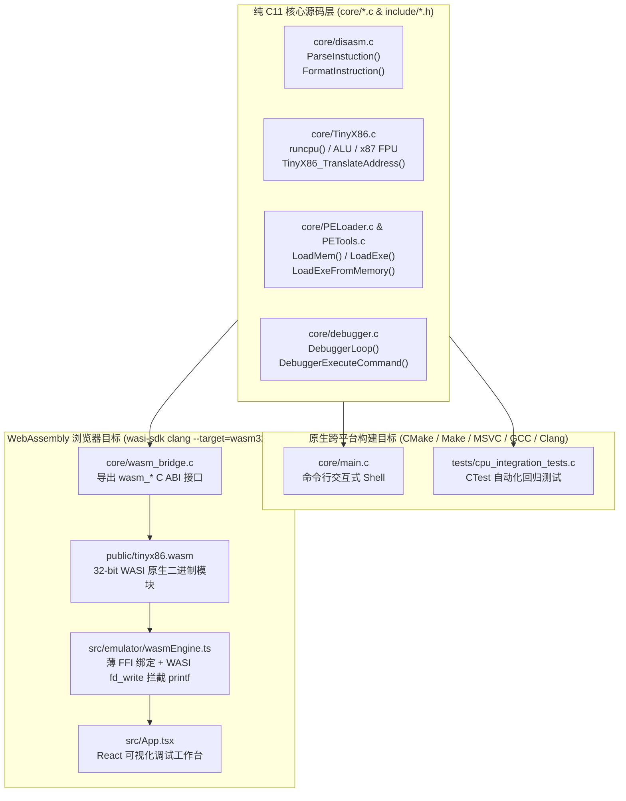

# TinyX86 —— 为深入理解 C 语言与 x86 汇编而生的轻量级 CPU 模拟器与交互式调试器

[](https://582835293.github.io/TinyX86/)
[](https://stackblitz.com/github/582835293/TinyX86)

[](#7-跨平台构建指南windows--linux--macos--wasi-wasm)
[](#3-架构设计纯-c11-内核直通跨平台命令行与-webassembly-前端)
[](#5-已实现的-x86--x87-指令集全景矩阵)

> **“What I cannot create, I do not understand.” —— Richard Feynman**
>
> 在逆向工程（滴水逆向）与底层系统安全的学习过程中，“看懂反汇编器输出的汇编文本”只是第一步；唯有亲手用纯 C 语言把**取指（Fetch）**、**表驱动解码（Table-Driven Decode）**、**复杂寻址（ModR/M + SIB Effective Address）**、**算术逻辑单元（ALU）**、**标志位硬件演化（EFLAGS）**、**函数调用栈帧（Stack Frame）**以及 **x87 浮点环形栈（FPU Ring Stack）**逐行写出来，才能真正站在 CPU 硬件电路与编译器生成器的视角彻底吃透 x86 汇编。

**TinyX86** 是一个完全采用 **标准 C11 语言**从零编写的轻量级 **x86-32 CPU 与 x87 FPU 指令集模拟器**，配套 **简易 PE32 节区映射 / 原始机器码加载器** 与 **类 GDB/OllyDbg/WinDbg 命令行交互式调试器**。

为了让这套纯 C11 代码既能在本地终端调试，又能在浏览器中直观展示内部状态，项目通过 **WASI Clang (`wasm32-wasi`)** 将 `core/*.c` **100% 原生 C 代码直接编译为 WebAssembly (`public/tinyx86.wasm`)**，驱动在线可视化调试工作台——**零其他语言重写，浏览器里的每一次单步执行、反汇编、寄存器修改和 `printf` 终端输出，全部直接运行自仓库中的 C 语言源码**。

---

### 🌐 在线免安装直接体验（原生 C11 → WebAssembly 实时驱动）

无需在本地安装编译器，点击下方链接即可在浏览器中直接运行由 `core/*.c` 编译出的 `tinyx86.wasm`，单步调试 `power(2.0, 3)` 递归栈帧、观察 `EFLAGS` 标志位与 `x87 FPU` 环形栈变化，或上传无外部依赖的 `.exe` / `.bin` 机器码：

- 👉 **[入口一：GitHub Pages 在线可视化调试工作台 (`https://582835293.github.io/TinyX86/`)](https://582835293.github.io/TinyX86/)**
- 👉 **[入口二：在 StackBlitz 云端容器中打开并运行 (`stackblitz.com`)](https://stackblitz.com/github/582835293/TinyX86)**

[](https://582835293.github.io/TinyX86/)

> **上图：TinyX86 可视化调试工作台真实运行截图**
> - **顶部工具栏**：支持一键切换 3 套内置汇编载荷（`power(2.0, 3)` 递归浮点运算、`1..10` 循环累加、`DOS INT 21h` 字符串输出）、单步步入 `Step Into (s)`、单步步过 `Step Over (n)`、继续运行 `Continue (c)`、重置 `Reset` 以及上传本地 `.EXE / .BIN`（支持键盘快捷键 `s` / `n` / `c` / `r` / `u` / `k` / `h` 直接触发）。
> - **左侧硬件状态面板**：实时读取 C 结构体 `CPU_Context` 中的 8 个 32 位通用寄存器（`EAX~EDI` 及高低位拆分视图）、`EIP`、6 个段寄存器（`ES/CS/SS/DS/FS/GS`）、完整 `EFLAGS` 标志位（`CF/PF/AF/ZF/SF/TF/IF/DF/OF/NT/IOPL`，点击即可调用 C 函数 `SetCpuState` 实时翻转）与 `x87 FPU` 环形寄存器栈（`R0~R7` 物理寄存器与 `ST(0)~ST(7)` 逻辑栈顶映射）。
> - **中部反汇编与交互式终端**：上方直接调用 `core/disasm.c` 的 `ParseInstuction()` 与 `FormatInstruction()` 渲染反汇编列表（点击任意行即可调用 `DebuggerToggleBreakpoint` 切换断点）；下方直接调用 `core/debugger.c` 的 `DebuggerExecuteCommand()` 并通过 WASI `fd_write` 实时拦截 C 语言 `printf` 标准输出流。
> - **右侧多维分析面板**：包含 `Stack`（实时栈帧 `ESP`/`EBP` 双指针标注）、`Mem`（任意虚拟地址 Hex + ASCII 内存转储）、`PE32`（由 `core/PETools.c` 解析的 DOS/NT 头与节区映射表）、`C Tests`（在 WASM 内直接运行 C 集成测试套件并报告 `sizeof(CPU_Context)` 与 `sizeof(DecodeContext)`）以及 `x86 & Build` 核心速查手册。

---

## 目录

1. [项目初心：为什么坚持用纯 C 语言手写 x86 模拟器？](#1-项目初心为什么坚持用纯-c-语言手写-x86-模拟器)
2. [13 个敏捷冲刺（Sprint 1 ~ Sprint 13）演进路线图](#2-13-个敏捷冲刺sprint-1--sprint-13演进路线图)
3. [架构设计：纯 C11 内核直通跨平台命令行与 WebAssembly 前端](#3-架构设计纯-c11-内核直通跨平台命令行与-webassembly-前端)
4. [从 C 源码深挖 8 大 x86 汇编与 CPU 底层核心机制](#4-从-c-源码深挖-8-大-x86-汇编与-cpu-底层核心机制)
   - [4.1 通用寄存器的物理重叠（`REG32` Union 与 8 位寄存器编码陷阱）](#41-通用寄存器的物理重叠reg32-union-与-8-位寄存器编码陷阱)
   - [4.2 `EFLAGS` 标志寄存器完整位图与硬件加减法公式（CF / OF / AF / TF / NT / IOPL）](#42-eflags-标志寄存器完整位图与硬件加减法公式cf--of--af--tf--nt--iopl)
   - [4.3 表驱动指令解码器（Prefix 前缀状态机 + 单/双字节 Opcode 表 + Group 扩展）](#43-表驱动指令解码器prefix-前缀状态机--单双字节-opcode-表--group-扩展)
   - [4.4 `ModR/M` + `SIB` 寻址公式与 `LEA` / `MOV` 的本质分野](#44-modrm--sib-寻址公式与-lea--mov-的本质分野)
   - [4.5 条件指令族（`Jcc` / `CMOVcc` / `SETcc`）低 4 位正交条件矩阵](#45-条件指令族jcc--cmovcc--setcc低-4-位正交条件矩阵)
   - [4.6 `cdecl` 函数栈帧生命周期、“烫烫烫” (`0xCCCCCCCC`) 与递归回溯剖析](#46-cdecl-函数栈帧生命周期烫烫烫-0xcccccccc-与递归回溯剖析)
   - [4.7 x87 FPU 8 寄存器环形栈（Ring Stack）与经典 `FNSTSW AX + SAHF` 浮点分支](#47-x87-fpu-8-寄存器环形栈ring-stack与经典-fnstsw-ax--sahf-浮点分支)
   - [4.8 32 位客户机虚拟地址转换层（让 32 位 x86 机器码安全运行在 64 位宿主与 WASM 上）](#48-32-位客户机虚拟地址转换层让-32-位-x86-机器码安全运行在-64-位宿主与-wasm-上)
5. [已实现的 x86 / x87 指令集全景矩阵](#5-已实现的-x86--x87-指令集全景矩阵)
6. [项目能力边界与当前局限性（重要说明）](#6-项目能力边界与当前局限性重要说明)
7. [跨平台构建指南（Windows / Linux / macOS / WASI-WASM）](#7-跨平台构建指南windows--linux--macos--wasi-wasm)
8. [交互式调试器（Debugger）完整命令手册与快捷键指南](#8-交互式调试器debugger完整命令手册与快捷键指南)
9. [进阶实验：如何自己编写并编译可在 TinyX86 中运行的 C / 汇编程序？](#9-进阶实验如何自己编写并编译可在-tinyx86-中运行的-c--汇编程序)
10. [如何同步更新 Git 子模块（`Core-x86-Disassembler` 与 `PETools`）](#10-如何同步更新-git-子模块core-x86-disassembler-与-petools)
11. [自动化测试与验证体系](#11-自动化测试与验证体系)
12. [扩展文档与关联仓库生态](#12-扩展文档与关联仓库生态)

---

## 1. 项目初心：为什么坚持用纯 C 语言手写 x86 模拟器？

在学习 C 语言指针、内存布局与 x86 汇编逆向时，仅靠阅读教材往往会留下许多似懂非懂的盲区：
- **寄存器位宽与别名**：为什么 `mov al, 0xFF` 不会清空 `EAX` 的高 24 位？为什么 8 位寄存器编号 `0~3` 是 `AL/CL/DL/BL`，到了 `4~7` 却变成了高字节 `AH/CH/DH/BH`？
- **标志位硬件逻辑**：CPU 内部其实只有一套补码加法器，它根本不知道操作数是 `int` 还是 `unsigned int`。那么 `ADD`、`SUB`、`CMP` 是怎么同时算出无符号进借位 `CF` 和有符号溢出 `OF` 的？为什么 `INC` 和 `DEC` 更新全部算术标志位却偏偏**保留 `CF` 不变**？
- **复杂寻址字节流**：看到反汇编里的 `mov eax, dword ptr [ebp + ecx*4 - 0x18]`，机器码里的 `ModR/M` 和 `SIB` 字节到底是怎么按位拆解并算出有效地址（Effective Address）的？
- **栈帧与调用约定**：函数开头的 `push ebp; mov ebp, esp; sub esp, 0x40` 和结尾的 `mov esp, ebp; pop ebp; ret` 在栈内存里画出了怎样的图像？MSVC Debug 模式下的 `rep stosd` 是如何把未初始化局部变量填满 `0xCCCCCCCC`（“烫烫烫”）的？
- **x87 浮点协处理器**：为什么浮点指令操作的是 `ST(0)`、`ST(1)` 而不是固定编号寄存器？一次 `FLD` 压栈后，原来的 `ST(0)` 为什么会自动变成 `ST(1)`？

用 C 语言亲手把这套状态机写出来、跑通编译器生成的真实机器码，是打通 **“C 语言源码 ↔ 编译器机器码 ↔ CPU 硬件执行”** 闭环最硬核也最有效的路径。

---

## 2. 13 个敏捷冲刺（Sprint 1 ~ Sprint 13）演进路线图

本项目从最基础的寄存器结构体起步，历经 13 个递进式迭代完成（完整开发心路历程详见 [`docs/Kanxue_TinyX86_Blog.md`](docs/Kanxue_TinyX86_Blog.md)）：

| 阶段 | 迭代主题 | 核心交付成果 |
| :---: | --- | --- |
| **Sprint 1** | CPU 上下文建模与基础取指循环 | 定义 `REG32` 共用体、`CPU_Context`、`EIP` 步进与基础 `MOV r32, imm32` (`0xB8~0xBF`) |
| **Sprint 2** | 接入自研反汇编器与表驱动分派 | 集成 `ParseInstuction` 解码器，分离“取指解码（Decode）”与“语义执行（Execute）” |
| **Sprint 3** | `ModR/M` 与 `SIB` 寻址引擎 | 实现 `GetEffectiveAddress`、`ReadOperand`、`WriteOperand`，攻克 8/16/32 位内存与寄存器读写 |
| **Sprint 4** | ALU 算术逻辑单元与 `EFLAGS` 演化 | 实现 `ADD/OR/ADC/SBB/AND/SUB/XOR/CMP/TEST/INC/DEC/NEG/NOT` 及 `CF/PF/AF/ZF/SF/OF` 精确位运算 |
| **Sprint 5** | 硬件栈操作与函数调用基础设施 | 实现 `PUSH/POP`、`PUSHA/POPA`、`PUSHF/POPF`、`ENTER/LEAVE` 与栈顶指针 `ESP` 自动升降 |
| **Sprint 6** | 控制流、分支跳转与全条件码矩阵 | 实现 `JMP`、`CALL/RET`、`Jcc`（16 种条件）、`LOOP/LOOPE/LOOPNE`、`CMOVcc` 与 `SETcc` |
| **Sprint 7** | 乘除法与位扩展/移位指令群 | 实现 `MUL/IMUL`（单/双/三操作数）、`DIV/IDIV`、`SHL/SHR/SAR/ROL/ROR/RCL/RCR`、`CBW/CWDE/CDQ` |
| **Sprint 8** | 串操作指令与 `REP` 前缀循环 | 实现 `MOVS/STOS/LODS/CMPS/SCAS` 与 `REP/REPE/REPNE` 硬件级块拷贝与扫描 |
| **Sprint 9** | 简易 PE32 加载器 (`PELoader.c`) | 集成 `PETools`，实现 DOS/NT 头校验、节区虚拟地址拉伸映射与入口点 `OEP` 初始化 |
| **Sprint 10** | x87 FPU 浮点协处理器子系统 | 实现 8 寄存器环形栈（`SW.TOP`）、`FLD/FSTP/FILD/FISTP`、四则运算与 `FCOM/FNSTSW` 条件码联动 |
| **Sprint 11** | 交互式命令行调试器 (`debugger.c`) | 实现单步 `s`、步过 `n`、断点 `b/bl/bc`、寄存器 `r`、反汇编 `u`、栈回溯 `k`、内存查看与修改 `m/e/w` |
| **Sprint 12** | GoogleTest / CTest 自动化验证 | 构建指令解码、ALU 标志位、相对分支与 FPU 环形栈回归测试套件 |
| **Sprint 13** | 跨平台 64 位寻址改造与 C11→WASM 工作台 | 引入 32 位客户机虚拟地址转换层，支持 Windows/Linux/macOS 全平台编译，并通过 WASI Clang 将 C 内核直通浏览器 |

---

## 3. 架构设计：纯 C11 内核直通跨平台命令行与 WebAssembly 前端

本项目的核心原则是 **“单一事实来源（Single Source of Truth in C11）”**——无论是本地编译出的原生命令行程序 `TinyX86`，还是浏览器中运行的在线可视化调试器，底层执行的都是完全相同的 `core/*.c` 代码：



### 目录结构一览

```text
TinyX86/
├── include/                      # 核心 C11 公开头文件 (.h)
│   ├── TinyX86.h                 # CPU_Context、REG32、EFLAGS、FPU 结构体与虚拟内存转换声明
│   ├── PELoader.h                # PE32 文件/内存映像加载 (LoadExe / LoadExeFromMemory / LoadMem)
│   ├── debugger.h                # 交互式调试器循环与单条命令执行 API (DebuggerExecuteCommand)
│   └── compat/                   # 跨平台内置 disasm.h 与 PETools.h 头文件（避免遮蔽 deps/ 子模块）
├── core/                         # 核心 C11 实现源码 (.c) —— 本地 CLI 与 WebAssembly 共用同一套源码
│   ├── TinyX86.c                 # CPU 取指-解码-执行主循环、ModR/M+SIB 寻址、ALU、x87 FPU 实现
│   ├── disasm.c                  # 表驱动 x86-32 解码器与 Intel 汇编语法格式化器
│   ├── PELoader.c                # 虚拟内存区域注册、PE32 节区拉伸映射与栈空间初始化
│   ├── PETools.c                 # 跨平台标准 C11 PE32 头部 (DOS/NT/Section) 解析实现
│   ├── debugger.c                # 调试器核心实现 (s/n/c/b/bl/bc/r/u/k/m/w/e/ew/ed)
│   ├── main.c                    # 本地命令行交互式 Shell 入口与内置 power(2.0, 3) 机器码
│   └── wasm_bridge.c             # WebAssembly C ABI 导出层 (供前端直接调用 C 函数与读取 CPU_Context)
├── deps/                         # Git Submodules 外部子模块挂载目录 (可选)
│   ├── Core-x86-Disassembler/    # 独立 x86 反汇编引擎子模块仓库
│   └── PETools/                  # 独立 PE 工具库子模块仓库
├── tests/                        # 原生 C 自动化测试套件
│   └── cpu_integration_tests.c   # CTest 集成测试 (指令解码、ALU、栈、分支、x87 FPU)
├── public/
│   └── tinyx86.wasm              # 由 core/*.c 通过 WASI Clang 直接编译生成的 WebAssembly 模块
├── src/                          # Web 可视化调试前端界面 (仅负责 UI 渲染与调用 tinyx86.wasm)
│   ├── emulator/
│   │   ├── wasmEngine.ts         # WASI 实例化、C printf 标准输出流拦截与 C 导出函数绑定
│   │   └── types.ts              # 与 C 结构体对应的前端状态显示类型定义
│   └── App.tsx                   # 三栏式调试器工作台界面与键盘快捷键绑定
├── docs/                         # 深度技术文档与开发笔记
│   ├── images/web-debugger-screenshot.png
│   ├── architecture.md           # 系统架构、内存转换层、WASM 桥接与能力边界详解
│   ├── project-relationships.md  # Git 子模块同步更新保姆级指南
│   ├── validation.md             # 跨平台构建与测试验证矩阵
│   └── Kanxue_TinyX86_Blog.md    # 看雪技术长文：13 个敏捷冲刺手写 x86 模拟器全记录
├── CMakeLists.txt                # 跨平台 CMake 构建脚本 (支持 Win32/x64, Linux, macOS)
├── CMakePresets.json             # Visual Studio / CLion / CLI 跨平台预设配置
└── Makefile                      # GNU Make 构建脚本 (含 make / make test / make wasm / make web)
```

---

## 4. 从 C 源码深挖 8 大 x86 汇编与 CPU 底层核心机制

### 4.1 通用寄存器的物理重叠（`REG32` Union 与 8 位寄存器编码陷阱）

x86 架构自 16 位 8086 演进至 32 位 IA-32，要求 32 位通用寄存器（如 `EAX`）的低 16 位必须可直接作为 `AX` 访问，而 `AX` 又可拆分为高 8 位 `AH`（bits 8..15）与低 8 位 `AL`（bits 0..7）。

在 `include/TinyX86.h` 中，我们利用 C 语言小端序（Little-Endian）下的 `union + struct` 实现了零开销硬件级重叠：

```c
typedef union {
    uint32_t I32;       // 32 位全长寄存器 (如 EAX)
    uint16_t I16;       // 低 16 位子寄存器 (如 AX)
    struct {
        uint8_t L;      // 低 8 位 (bits 0..7, 如 AL)
        uint8_t H;      // 次低 8 位 (bits 8..15, 如 AH)
    } I8;
} REG32;
```

**8 位寄存器索引编码陷阱（`core/TinyX86.c` 中的 `ReadGPR` / `WriteGPR`）**：
在 ModR/M 或 Opcode 的 3-bit 寄存器编号（`0~7`）中：
- 当操作数宽度为 **16 位或 32 位** 时，`0~7` 依次对应：`EAX(0), ECX(1), EDX(2), EBX(3), ESP(4), EBP(5), ESI(6), EDI(7)`。
- 当操作数宽度为 **8 位** 时，`0~3` 对应 `AL(0), CL(1), DL(2), BL(3)`，但 **`4~7` 并不是 `ESP~EDI` 的低 8 位，而是回绕指向前四个寄存器的高 8 位：`AH(4), CH(5), DH(6), BH(7)`**！

```c
uint32_t ReadGPR(CPU_Context* ctx, int reg_index, int byte_len) {
    if (byte_len == 4) return ctx->GPR[reg_index].I32;
    if (byte_len == 2) return ctx->GPR[reg_index].I16;
    if (byte_len == 1) {
        if (reg_index < 4) return ctx->GPR[reg_index].I8.L;       // 0..3 -> AL, CL, DL, BL
        else               return ctx->GPR[reg_index - 4].I8.H;   // 4..7 -> AH, CH, DH, BH
    }
    return 0;
}
```

---

### 4.2 `EFLAGS` 标志寄存器完整位图与硬件加减法公式（CF / OF / AF / TF / NT / IOPL）

在 `include/TinyX86.h` 与 `core/debugger.c` 中，TinyX86 完整建模了 32 位 `EFLAGS` 寄存器的状态标志、控制标志与系统标志位：

| 位 (Bit) | 缩写 | 英文全称 | 类别 | 核心作用与触发机制 |
| :---: | :---: | --- | :---: | --- |
| **Bit 0** | **`CF`** | Carry Flag | 状态标志 | **无符号数进位/借位**：加法最高位产生进位或减法产生借位时置 `1`；`INC`/`DEC` **不修改此位** |
| **Bit 1** | `1` | Reserved | 保留位 | IA-32 架构规范要求 Bit 1 恒为 `1`（因此初始 Raw EFLAGS 为 `0x00000202`） |
| **Bit 2** | **`PF`** | Parity Flag | 状态标志 | **低 8 位偶校验标志**：运算结果**最低字节（bits 0..7）**中 `1` 的个数为偶数时置 `1` |
| **Bit 4** | **`AF`** | Auxiliary Carry Flag | 状态标志 | **半进位标志**：Bit 3 向 Bit 4 产生进位或借位时置 `1`（用于 BCD 码调整指令） |
| **Bit 6** | **`ZF`** | Zero Flag | 状态标志 | **零标志**：运算结果所有有效位全为 `0` 时置 `1`，否则置 `0` |
| **Bit 7** | **`SF`** | Sign Flag | 状态标志 | **符号标志**：等于运算结果的最高有效位（MSB，8 位看 Bit 7，16 位看 Bit 15，32 位看 Bit 31） |
| **Bit 8** | **`TF`** | Trap Flag | 系统/调试 | **单步陷阱标志**：置 `1` 时 CPU 每执行完一条指令自动触发 `#DB`（INT 1）单步调试异常 |
| **Bit 9** | **`IF`** | Interrupt Enable Flag | 系统标志 | **外部可屏蔽中断允许标志**：置 `1` 时允许响应外部硬件中断（`STI` 置 1，`CLI` 清 0） |
| **Bit 10** | **`DF`** | Direction Flag | 控制标志 | **串操作方向标志**：`0` 表示地址递增（`CLD`），`1` 表示地址递减（`STD`，用于 `MOVS/STOS` 等） |
| **Bit 11** | **`OF`** | Overflow Flag | 状态标志 | **有符号数溢出标志**：补码运算结果超出当前位宽有符号数表示范围时置 `1` |
| **Bits 12..13** | **`IOPL`** | I/O Privilege Level | 系统标志 | **I/O 特权级（0~3）**：定义当前任务执行 `IN/OUT/CLI/STI` 所需的最低环级（Ring） |
| **Bit 14** | **`NT`** | Nested Task Flag | 系统标志 | **嵌套任务标志**：控制 `IRET` 指令是从栈弹出返回地址还是通过 TSS 切换回前一个任务 |

**ALU 标志位核心位运算公式（见 `core/TinyX86.c` -> `ALU_Calculate`）**：
```c
uint32_t sign_mask = (byte_len == 1) ? 0x80 : (byte_len == 2) ? 0x8000 : 0x80000000;

// 1. ZF 与 SF
ctx->EFLAGS.ZF = (truncated_res == 0) ? 1 : 0;
ctx->EFLAGS.SF = (truncated_res & sign_mask) ? 1 : 0;

// 2. AF (半进位：利用异或消除低 4 位向 Bit 4 的无进位加法结果)
ctx->EFLAGS.AF = ((dest ^ src ^ truncated_res) & 0x10) ? 1 : 0;

// 3. 加法 (ADD) 的 CF 与 OF
ctx->EFLAGS.CF = (truncated_res < dest) ? 1 : 0;
ctx->EFLAGS.OF = (((dest ^ truncated_res) & (src ^ truncated_res)) & sign_mask) ? 1 : 0;

// 4. 减法/比较 (SUB / CMP) 的 CF 与 OF
ctx->EFLAGS.CF = (dest < src) ? 1 : 0;
ctx->EFLAGS.OF = (((dest ^ src) & (dest ^ truncated_res)) & sign_mask) ? 1 : 0;
```

---

### 4.3 表驱动指令解码器（Prefix 前缀状态机 + 单/双字节 Opcode 表 + Group 扩展）

`core/disasm.c` 采用工业级反汇编器通用的**多阶段表驱动架构**：
1. **阶段一：指令前缀扫描（Prefix Loop）**：循环识别最大 4 个前缀字节：
   - 重复前缀：`0xF3` (`REP`/`REPE`)、`0xF2` (`REPNE`)
   - 操作数/地址宽度反转前缀：`0x66`（32 位与 16 位操作数切换）、`0x67`（地址宽度切换）
   - 段超越前缀：`0x26` (`ES:`), `0x2E` (`CS:`), `0x36` (`SS:`), `0x3E` (`DS:`), `0x64` (`FS:`), `0x65` (`GS:`)
2. **阶段二：主操作码查表（1-Byte vs `0x0F` 2-Byte Opcode Table）**：
   - 普通指令直接索引 `g_OpcodeTable1[opcode]`（256 项）；
   - 若首字节为转义码 `0x0F`，则再读一字节索引 `g_OpcodeTable2[opcode2]`（覆盖 `Jcc rel32`、`MOVZX`、`MOVSX`、`CMOVcc`、`SETcc`、`IMUL Gv, Ev` 等扩展指令）。
3. **阶段三：Group 扩展操作码（`0x80~0x83`, `0xC0/0xC1/0xD0~0xD3`, `0xF6/0xF7`, `0xFE/0xFF`）**：
   - 当一字节 Opcode 不足以编码所有指令时，Intel 借用了紧随其后的 **`ModR/M` 字节中间 3 位（`reg` 字段，`0~7`）** 作为次级 Opcode：
     - **Group 1 (`0x80~0x83`)**：`0=ADD, 1=OR, 2=ADC, 3=SBB, 4=AND, 5=SUB, 6=XOR, 7=CMP`
     - **Group 2 (`0xC0/0xC1/0xD0~0xD3`)**：`0=ROL, 1=ROR, 2=RCL, 3=RCR, 4=SHL, 5=SHR, 7=SAR`
     - **Group 3 (`0xF6/0xF7`)**：`0=TEST Ib/Iz, 2=NOT, 3=NEG, 4=MUL, 5=IMUL, 6=DIV, 7=IDIV`
     - **Group 5 (`0xFF`)**：`0=INC Ev, 1=DEC Ev, 2=CALL Ev, 4=JMP Ev, 6=PUSH Ev`

---

### 4.4 `ModR/M` + `SIB` 寻址公式与 `LEA` / `MOV` 的本质分野

x86 最强大的内存寻址表达式 `[Base + Index * Scale + Displacement]` 由 `ModR/M`（1 字节）和可选的 `SIB`（1 字节）共同决定：

```text
  ModR/M Byte:  [ Mod (2b) | Reg/Opcode (3b) | R/M (3b) ]
  SIB Byte:     [ Scale(2b)|   Index (3b)    | Base(3b) ]
```

在 `core/TinyX86.c` 的 `GetEffectiveAddress(CPU_Context* ctx, DecodeContext* d_ctx)` 中：
1. 若 `Mod != 3` 且 `R/M == 4 (0b100)`，则存在 `SIB` 字节：
   - **基址 `Base`**：若 `SIB.base == 5` 且 `Mod == 0`，则无基址寄存器（仅有 32 位偏移 `disp32`）；否则读取 `GPR[SIB.base]`。
   - **变址 `Index × Scale`**：若 `SIB.index != 4`（`ESP` 不可作为变址寄存器），则加上 `GPR[SIB.index] << SIB.scale`（乘数为 `1, 2, 4, 8`）。
2. 若无 `SIB` 字节：
   - 当 `Mod == 0` 且 `R/M == 5 (0b101)` 时，直接返回 32 位绝对地址 `disp32`；否则读取 `GPR[R/M]` 并加上 8 位或 32 位有符号偏移 `disp`。
3. **`LEA` 与 `MOV` 的区别**：
   - `MOV reg, [mem]`：调用 `GetEffectiveAddress` 得到地址 `addr` -> 调用 `MemRead(addr, size)` 读出内存值 -> 写入 `reg`。
   - `LEA reg, [mem]`：调用 `GetEffectiveAddress` 得到地址 `addr` -> **直接把 `addr` 数值写入 `reg`，完全不访问内存**！

---

### 4.5 条件指令族（`Jcc` / `CMOVcc` / `SETcc`）低 4 位正交条件矩阵

x86 指令集设计中最优雅的正交特性之一，就是短条件跳转 `0x70~0x7F`、近条件跳转 `0x0F 0x80~0x8F`、条件传送 `0x0F 0x40~0x4F`（`CMOVcc`）和条件字节置位 `0x0F 0x90~0x9F`（`SETcc`）的 **低 4 位（`opcode & 0x0F`）完全共用同一个条件评估函数 `CheckCondition(ctx, cc)`**：

| `opcode & 0x0F` | 助记符后缀 | `CheckCondition` 布尔表达式 | 语义解释 |
| :---: | :---: | --- | --- |
| `0x0` / `0x1` | `O` / `NO` | `OF == 1` / `OF == 0` | 溢出 / 未溢出 |
| `0x2` / `0x3` | `B` (`NAE`, `C`) / `NB` (`AE`, `NC`) | `CF == 1` / `CF == 0` | **无符号 `<`** / **无符号 `>=`** |
| `0x4` / `0x5` | `Z` (`E`) / `NZ` (`NE`) | `ZF == 1` / `ZF == 0` | 相等 `==` / 不相等 `!=` |
| `0x6` / `0x7` | `BE` (`NA`) / `NBE` (`A`) | `(CF \|\| ZF)` / `(!CF && !ZF)` | **无符号 `<=`** / **无符号 `>`** |
| `0x8` / `0x9` | `S` / `NS` | `SF == 1` / `SF == 0` | 负数（符号位为 1） / 非负数 |
| `0xA` / `0xB` | `P` (`PE`) / `NP` (`PO`) | `PF == 1` / `PF == 0` | 偶校验 / 奇校验 |
| `0xC` / `0xD` | `L` (`NGE`) / `NL` (`GE`) | `SF != OF` / `SF == OF` | **有符号 `<`** / **有符号 `>=`** |
| `0xE` / `0xF` | `LE` (`NG`) / `NLE` (`G`) | `(ZF \|\| (SF != OF))` / `(!ZF && (SF == OF))` | **有符号 `<=`** / **有符号 `>`** |

---

### 4.6 `cdecl` 函数栈帧生命周期、“烫烫烫” (`0xCCCCCCCC`) 与递归回溯剖析

本仓库默认加载的测试载荷 `g_TestCode`（83 字节）提取自 MSVC Debug 模式编译的递归函数 `double power(double base, int exp)`：

```c
double power(double base, int exp) {
    if (exp <= 0) return 1.0;
    return base * power(base, exp - 1);
}
```

对应的完整机器码与栈帧演化如下：
```nasm
; === 调用者 (Caller: main) ===
00400000: 6A 03                push 0x3             ; 压入参数2: int exp = 3
00400002: 68 00 00 00 40       push 0x40000000      ; 压入参数1高32位: double base = 2.0 (IEEE-754: 0x4000000000000000)
00400007: 6A 00                push 0x0             ; 压入参数1低32位
00400009: E8 06 00 00 00       call 0x00400014      ; 压入返回地址 0x0040000E 并跳转到 power()
0040000E: 83 C4 0C             add esp, 0xC         ; cdecl 调用者平栈 (释放 12 字节参数)
00400011: CC                   int3                 ; 软断点停机，此时 FPU ST(0) = 8.000000!

; === 被调用者 (Callee: power) 函数序言与 Debug 栈初始化 ===
00400014: 55                   push ebp             ; 保存上一层函数的栈底 EBP
00400015: 8B EC                mov ebp, esp         ; 建立当前函数的栈帧基准点 EBP
00400017: 83 EC 40             sub esp, 0x40        ; 抬高栈顶，开辟 64 字节局部变量空间
0040001A: 8D 7D C0             lea edi, [ebp-0x40]  ; EDI 指向局部变量区起始地址
0040001D: B9 10 00 00 00       mov ecx, 0x10        ; 循环 16 次 (16 * 4 = 64 字节)
00400022: B8 CC CC CC CC       mov eax, 0xCCCCCCCC  ; 0xCC 即 INT 3 软断点，双字节 0xCCCC 在 GBK 下即“烫”字
00400027: F3 AB                rep stosd            ; 将 [EBP-0x40 .. EBP] 填满 0xCCCCCCCC！
```

当你在调试器中单步执行到 `0x00400029` 并输入 `k 16` 查看栈内存时，就能亲眼看到栈上整齐排列的 `0xCCCCCCCC`、保存的旧 `EBP`、返回地址以及传入的浮点/整型参数。

---

### 4.7 x87 FPU 8 寄存器环形栈（Ring Stack）与经典 `FNSTSW AX + SAHF` 浮点分支

x87 浮点协处理器内部有 8 个 80 位（模拟器中以 `double` 64 位双精度表示）物理寄存器 `R0 ~ R7`。不同于通用寄存器的固定寻址，x87 通过状态字 `SW.TOP`（3-bit，取值 `0~7`）将其维护成一个**环形栈**：
- **逻辑寄存器 `ST(i)` 到物理寄存器的映射公式**：`phys_idx = (SW.TOP + i) & 7`。
- **压栈（`FPU_Push`）**：先将 `SW.TOP = (SW.TOP - 1) & 7`（如从 `0` 减为 `7`），再写入 `Regs[SW.TOP]`。
- **弹栈（`FPU_Pop`）**：先读出 `Regs[SW.TOP]`，再将 `SW.TOP = (SW.TOP + 1) & 7`。
- **浮点比较与条件跳转**：早期 x86 在还没有 `FCOMI` 指令时，浮点比较指令 `FCOM` / `FCOMP` / `FUCOMPP` 会将比较结果写入 FPU 状态字的 **`C3` (Bit 14)、`C2` (Bit 10)、`C0` (Bit 8)**，随后编译器生成经典的组合指令：
  1. `fnstsw ax`（Opcode `0xDF 0xE0`）：把 FPU 状态字 `SW` 拷贝到 `AX` 寄存器；
  2. `sahf`（Opcode `0x9E`）：将 `AH` 的特定位直接加载进 `EFLAGS` 的 `SF, ZF, AF, PF, CF`（此时 `C3 -> ZF`，`C0 -> CF`，`C2 -> PF`）！
  3. 紧接着即可使用普通的 `JE`、`JB`、`JA` 完成浮点数条件跳转。TinyX86 对这一完整链路进行了字节级精确还原。

---

### 4.8 32 位客户机虚拟地址转换层（让 32 位 x86 机器码安全运行在 64 位宿主与 WASM 上）

在 32 位 x86 机器码中，代码段基址通常位于 `0x00400000`，栈顶位于 `0x0010FFE0`。如果在 64 位操作系统（Linux x86_64、macOS Apple Silicon、Windows x64）上直接把 `uint32_t addr` 强转为宿主指针 `(uint8_t*)(uintptr_t)addr` 解引用，必然触发段错误（Segmentation Fault）。

为此，`core/TinyX86.c` 实现了轻量级 **客户机虚拟内存区域表（Guest Virtual Memory Region Table）**：
```c
bool     TinyX86_RegisterRegion(uint32_t guest_base, void* host_ptr, uint32_t size);
uint8_t* TinyX86_TranslateAddress(uint32_t guest_addr);
```
- 当 `LoadMem()` 或 `LoadExe()` 分配宿主堆内存（`calloc`）后，会将 `[guest_base, guest_base + size)` 与宿主指针 `host_ptr` 注册到映射表中。
- 无论宿主是 32 位 Windows、64 位 Linux/macOS 还是 WebAssembly 线性内存，所有 `MemRead()`、`MemWrite()`、取指解码与调试器内存转储均通过 `TinyX86_TranslateAddress()` 完成线性偏移换算，实现了 **100% 平台无关的内存安全隔离**。

---

## 5. 已实现的 x86 / x87 指令集全景矩阵

| 指令分类 | 已实现指令助记符 | 关键机器码与实现细节 |
| --- | --- | --- |
| **数据传送与类型扩展** | `MOV` (`88~8E`, `A0~A3`, `B0~BF`, `C6/C7`), `MOVZX` (`0F B6/B7`), `MOVSX` (`0F BE/BF`), `LEA` (`8D`), `XCHG` (`86/87`, `90~97`), `NOP` (`90`), `CBW`/`CWDE` (`98`), `CWD`/`CDQ` (`99`), `CMOVcc` (`0F 40~4F`), `SETcc` (`0F 90~9F`), `SAHF` (`9E`), `LAHF` (`9F`) | 完整支持 `0x66` 16 位操作数前缀、段寄存器传送、零扩展与符号位扩展 |
| **算术与逻辑运算 (ALU)** | `ADD`, `OR`, `ADC`, `SBB`, `AND`, `SUB`, `XOR`, `CMP`, `TEST`, `INC`, `DEC`, `NOT`, `NEG`, `MUL`, `IMUL` (单/双/三操作数 `F6/F7`, `0F AF`, `69/6B`), `DIV`, `IDIV` | 精确计算 8/16/32 位 `CF, PF, AF, ZF, SF, OF`；支持带进借位的 64 位长整数加减（`ADC`/`SBB`）与除零保护 |
| **移位与循环移位 (Group 2)** | `ROL`, `ROR`, `RCL`, `RCR`, `SHL` (`SAL`), `SHR`, `SAR` (`C0/C1`, `D0~D3`) | 移位计数自动掩码 `& 0x1F`，精确维护最后移出位 `CF` 与单比特移位 `OF` |
| **硬件栈与函数栈帧** | `PUSH` (`50~57`, `68/6A`, `FF /6`, 段寄存器), `POP` (`58~5F`, `8F /0`, 段寄存器), `PUSHA`/`PUSHAD` (`60`), `POPA`/`POPAD` (`61`), `PUSHF`/`PUSHFD` (`9C`), `POPF`/`POPFD` (`9D`), `ENTER` (`C8`), `LEAVE` (`C9`) | `POPA` 自动跳过 `ESP` 槽位；`POPFD` 精确写回全部状态标志与 `TF/IF/DF/NT/IOPL` |
| **控制流与循环跳转** | `JMP` (`EB` rel8, `E9` rel32, `FF /4` r/m32), `Jcc` (`70~7F` rel8, `0F 80~8F` rel32), `JCXZ`/`JECXZ` (`E3`), `CALL` (`E8` rel32, `FF /2` r/m32), `RET` (`C3`, `C2` imm16), `LOOP` (`E2`), `LOOPE` (`E1`), `LOOPNE` (`E0`) | 覆盖全部 16 种条件跳转码与 `stdcall` 被调用者平栈返回 `RET imm16` |
| **串操作与块指令** | `MOVSB`/`W`/`D` (`A4/A5`), `CMPSB`/`W`/`D` (`A6/A7`), `STOSB`/`W`/`D` (`AA/AB`), `LODSB`/`W`/`D` (`AC/AD`), `SCASB`/`W`/`D` (`AE/AF`) + `REP` (`F3`) / `REPNE` (`F2`) | 根据 `EFLAGS.DF` 自动增减 `ESI`/`EDI`；支持 `REPE CMPS/SCAS` 与 `REPNE CMPS/SCAS` 条件提前终止 |
| **中断与标志位指令** | `INT 3` (`CC`), `INT Ib` (`CD`), `HLT` (`F4`), `CMC` (`F5`), `CLC` (`F8`), `STC` (`F9`), `CLI` (`FA`), `STI` (`FB`), `CLD` (`FC`), `STD` (`FD`) | 内置 `INT 21h` 极简高层模拟（`AH=02h` 字符输出、`AH=09h` `$` 结尾字符串输出、`AH=4Ch` 退出） |
| **x87 FPU 浮点协处理器** | `FLD`, `FST`, `FSTP`, `FILD`, `FIST`, `FISTP`, `FLDCW`, `FNSTCW`, `FSTSW`, `FNSTSW AX`, `FADD`/`P`, `FMUL`/`P`, `FSUB`/`R`/`P`, `FDIV`/`R`/`P`, `FIADD`, `FIMUL`, `FISUB`/`R`, `FIDIV`/`R`, `FCOM`/`P`/`PP`, `FUCOMPP`, `FCHS`, `FABS`, `FLD1`, `FLDZ`, `FLDPI`, `FLDL2T`, `FLDL2E`, `FLDLG2`, `FLDLN2`, `FCLEX`, `FINIT` | 支持 32 位 `float`、64 位 `double` 及 16/32/64 位整型内存操作数与环形栈 `ST(i)` 运算 |

---

## 6. 项目能力边界与当前局限性（重要说明）

**TinyX86 的定位是“面向 C 语言、x86 汇编与逆向工程学习者的指令级教学模拟器”**，而非完整模拟操作系统内核与动态链接器的全系统虚拟机（如 QEMU）。为了帮助读者清晰了解本项目的能力边界，现将已实现范围与未实现限制说明如下：

| 维度 | ✅ 已实现能力 (Implemented) | ❌ 未实现 / 不在当前范围内 (Out of Scope) |
| --- | --- | --- |
| **PE32 加载器 (`PELoader.c`)** | • 解析 `IMAGE_DOS_HEADER`、`IMAGE_NT_HEADERS32` 与节表（`IMAGE_SECTION_HEADER`）<br>• 按 `ImageBase + VirtualAddress` 将各节区（`.text`/`.data`/`.rdata`）拉伸拷贝到虚拟内存<br>• 分配 64KB 虚拟栈空间并将 `EIP` 指向入口点 `ImageBase + AddressOfEntryPoint` | • **未实现导入表（IAT）与导出表（EAT）解析**<br>• **未实现基址重定位表（`.reloc`）修复**<br>• 未实现 TLS 回调表（TLS Callbacks）、异常表（SEH）与资源表解析 |
| **操作系统 API 与系统调用** | • 在 `Execute_INT` 中通过极简高层模拟（HLE）拦截了 **DOS `INT 21h`** 的 3 个基础子功能：`AH=02h`（打印单字符）、`AH=09h`（打印 `$` 结尾字符串）、`AH=4Ch`（设置 `Halted = 1` 正常退出）<br>• 支持 `INT 3` (`0xCC`) 软断点拦截 | • **不支持任何 Windows Win32 API 或外部 DLL 动态链接**（如 `kernel32.dll`、`user32.dll`、`msvcrt.dll` 等）<br>• **不能直接运行包含标准 C 运行库（CRT 启动代码 `mainCRTStartup`）的常规编译 `.exe`**（因为 CRT 初始化会调用大量系统 DLL API）；仅支持无外部依赖的纯算法 PE32 程序（见第 9 节编译方法）或 `.bin` 原始机器码 |
| **CPU 指令集与硬件架构** | • 32 位平坦内存模型（Flat Memory Model）下的通用寄存器（`EAX~EDI`）、完整 `EFLAGS` 标志位与核心算术/逻辑/控制流/栈/串操作指令<br>• x87 FPU 8 寄存器环形栈与常用浮点算术/比较指令 | • **不支持 Ring 0 特权级指令**（如 `LGDT`、`LIDT`、`MOV CR0`、`IN`/`OUT`、`IRET`、`SYSENTER`）<br>• **不支持 GDT/LDT 段描述符权限检查与页表（Paging / MMU）硬件级地址保护**<br>• **不支持 MMX、SSE、AVX 等 SIMD 向量扩展指令集**及 64 位（x86_64）长模式指令 |

---

## 7. 跨平台构建指南（Windows / Linux / macOS / WASI-WASM）

### 7.1 使用 CMake 构建原生程序与测试（推荐，支持 MSVC / GCC / Clang）

项目根目录提供了标准 `CMakeLists.txt` 与 `CMakePresets.json`（Visual Studio 2022/2026 直接使用“打开本地文件夹”即可自动识别 Win32 与 x64 配置）：

```bash
# 1. 克隆仓库（包含子模块）
git clone --recurse-submodules https://github.com/582835293/TinyX86.git
cd TinyX86

# 2. 配置并编译（Linux / macOS / Windows 通用）
cmake -S . -B build -DCMAKE_BUILD_TYPE=Release
cmake --build build --config Release --parallel

# 3. 运行 CTest 自动化集成测试套件
ctest --test-dir build -C Release --output-on-failure

# 4. 启动 TinyX86 原生命令行交互式调试器
./build/bin/TinyX86              # Linux / macOS
.\build\bin\Release\TinyX86.exe  # Windows MSVC
```

### 7.2 使用 GNU Make 极速构建（Linux / macOS / MinGW）

```bash
make            # 编译 TinyX86 主程序与 cpu_integration_tests 至 build/make/
make test       # 编译并运行 C 语言集成测试
make run        # 编译并启动命令行交互式 TinyX86 Shell
make wasm       # 使用 WASI Clang 将 core/*.c 重新编译为 public/tinyx86.wasm
make web        # 启动本地 Web 可视化调试工作台 (http://localhost:3000)
make clean      # 清理构建产物
```

### 7.3 手动将 `core/*.c` 编译为 WebAssembly (`public/tinyx86.wasm`)

如果你修改了 `core/TinyX86.c`、`core/disasm.c` 或 `core/debugger.c`，除了推送到 GitHub 让 Actions 自动编译外，也可以在本地使用 [wasi-sdk](https://github.com/WebAssembly/wasi-sdk) 一条命令重新生成 `public/tinyx86.wasm`：

```bash
/path/to/wasi-sdk/bin/clang -std=c11 -O2 -Iinclude -Iinclude/compat \
  -Wl,--export-dynamic -Wl,--no-entry \
  core/TinyX86.c core/disasm.c core/PELoader.c core/PETools.c core/debugger.c core/wasm_bridge.c \
  -lm -o public/tinyx86.wasm
```

---

## 8. 交互式调试器（Debugger）完整命令手册与快捷键指南

无论是原生命令行 `TinyX86` 还是 Web 可视化调试工作台，均由 `core/debugger.c` 驱动，支持以下完整调试命令与键盘快捷键：

| 调试命令 | Web 全局快捷键 | 参数示例 | 功能详解 |
| :---: | :---: | --- | --- |
| **`s`** | **`S`** / `F7` / `F11` | `s` 或 `s 5` | **Step Into（单步步入）**：执行 1 条或连续执行 `N` 条指令，遇到 `CALL` 会进入子函数内部 |
| **`n`** | **`N`** / `F8` / `F10` | `n` | **Step Over（单步步过）**：遇到 `CALL`、`LOOP`、`REP STOSD`、`INT` 等块指令时全速执行至下一条指令地址（若中途命中断点则立即停下） |
| **`c`** | **`C`** / `F5` / `F9` | `c` | **Continue（继续运行）**：持续执行直到命中用户断点、`INT 3`（`0xCC`）软断点或 `HLT` 停机 |
| **`b`** | 点击反汇编行 | `b 400014` | **Toggle Breakpoint**：在指定十六进制地址设置或取消断点（最多 16 个） |
| **`bl` / `bc`** | - | `bl` / `bc` | **List / Clear Breakpoints**：列出当前所有断点 / 清空所有断点 |
| **`r`** | **`R`** | `r` | **Registers**：打印全部 32 位通用寄存器、段寄存器、`EFLAGS` 激活标志位（含 `TF/NT/IOPL`）及 `x87 FPU` 8 个物理/逻辑寄存器状态 |
| **`u`** | **`U`** | `u` 或 `u 12` | **Unassemble（反汇编）**：从当前 `EIP` 向后反汇编 `N` 条指令（输出地址、机器码字节流与 Intel 汇编助记符） |
| **`k`** | **`K`** | `k` 或 `k 12` | **Stack Dump（栈回溯）**：显示当前 `ESP` 栈顶附近的双字（DWORD）内存与 ASCII 字符，自动标注 `<--- ESP (Top)` 与 `<--- EBP (Frame)` |
| **`m`** | - | `m 400000` | **Memory Dump**：以 16 字节×4 行 Hex + ASCII 格式转储指定虚拟地址内存 |
| **`w`** | 点击左侧寄存器/标志位 | `w EAX 2A` / `w TF 1` | **Write State**：动态修改任意 32/16/8 位通用寄存器（`EAX/AX/AL/AH` 等）、段寄存器、标志位（`CF/PF/AF/ZF/SF/TF/IF/DF/OF/NT/IOPL`）或 FPU `TOP` |
| **`e` / `ew` / `ed`** | - | `e 400000 90 CC` | **Edit Memory**：向指定虚拟地址写入字节序列（`e`）、16 位字（`ew`）或 32 位双字（`ed`） |
| **`t`** | 顶部预设下拉框 | `t` | 重新加载默认内置测试 `g_TestCode`（递归幂运算 `power(2.0, 3)`） |
| **`h` / `?`** | **`H`** | `h` | 打印调试器命令帮助说明 |

---

## 9. 进阶实验：如何自己编写并编译可在 TinyX86 中运行的 C / 汇编程序？

由于 TinyX86 不包含 Windows 系统 DLL（`kernel32.dll` / `msvcrt.dll`），如果你想自己写一段 C 代码或汇编代码编译成 `.exe` 或 `.bin` 放进 TinyX86 单步调试，只需**关闭编译器的标准库启动代码（No CRT）并指定入口函数**即可！

### 9.1 使用 NASM 编译纯汇编 `.bin` 机器码
新建 `fib.asm`（计算斐波那契数列第 10 项存入 `EAX` 并触发 `INT 3`）：
```nasm
BITS 32
ORG 0x00400000

start:
    mov ecx, 10         ; 计算第 10 项
    xor eax, eax        ; f(0) = 0
    mov ebx, 1          ; f(1) = 1
.loop:
    mov edx, eax
    add edx, ebx        ; edx = f(n-2) + f(n-1)
    mov eax, ebx
    mov ebx, edx
    loop .loop
    int3                ; 停机供调试器观察 EAX (55 = 0x37)
    hlt
```
编译并在 TinyX86 中加载：
```bash
nasm -f bin fib.asm -o fib.bin
# 在命令行输入: b fib.bin ，或在 Web 调试器点击 "Load .EXE / .BIN" 上传 fib.bin
```

### 9.2 使用 MSVC 或 MinGW-w64 编译无 CRT 的纯算法 PE32 `.exe`
新建 `mini_pe.c`：
```c
// 不引用任何标准库头文件，直接定义入口点函数
int calc_sum(int n) {
    int s = 0;
    for (int i = 1; i <= n; i++) s += i;
    return s;
}

void __stdcall TinyEntry(void) {
    int result = calc_sum(100); // EAX = 5050 (0x13BA)
    __asm {
        mov ebx, result
        int 3
        hlt
    }
}
```
- **使用 MSVC (`cl.exe` x86) 编译**：
  ```cmd
  cl /c /GS- /Od /arch:IA32 mini_pe.c
  link /ENTRY:TinyEntry /SUBSYSTEM:CONSOLE /NODEFAULTLIB /FIXED mini_pe.obj /OUT:mini_pe.exe
  ```
- **使用 MinGW (`i686-w64-mingw32-gcc`) 编译**：
  ```bash
  i686-w64-mingw32-gcc -O0 -fno-stack-protector -nostdlib -Wl,-e,_TinyEntry@0 -Wl,--image-base,0x400000 mini_pe.c -o mini_pe.exe
  ```
生成的 `mini_pe.exe` 即可直接拖入 TinyX86（命令行 `e mini_pe.exe` 或 Web 端 `Load .EXE / .BIN`），完整观察 PE32 节表映射与函数调用栈帧！

---

## 10. 如何同步更新 Git 子模块（`Core-x86-Disassembler` 与 `PETools`）

本仓库通过 `.gitmodules` 关联了上游反汇编引擎仓库 `deps/Core-x86-Disassembler` 与 PE 解析库 `deps/PETools`。当你更新了子模块仓库并推送到 GitHub 后，只需在 `TinyX86` 根目录下执行以下 3 步：

```bash
# 第一步：确保子模块已初始化
git submodule update --init --recursive

# 第二步：从 GitHub 拉取子模块远端默认分支的最新提交
git submodule update --remote --merge deps/Core-x86-Disassembler

# 第三步：在 TinyX86 主仓库提交新的子模块版本指针并推送
git add deps/Core-x86-Disassembler
git commit -m "chore(submodule): sync Core-x86-Disassembler to latest"
git push origin main
```

> 详细的多仓库协作与常见问题排查请阅读 👉 **[《项目关系与 Git 子模块保姆级同步指南》(docs/project-relationships.md)](docs/project-relationships.md)**。

---

## 11. 自动化测试与验证体系

项目内置双重验证机制，确保每次修改 C 代码后指令解码与执行语义不发生退化：
1. **原生 CTest 集成测试 (`tests/cpu_integration_tests.c`)**：
   - 在 GitHub Actions 矩阵中自动跨 **5 个操作系统/编译器环境**（Ubuntu GCC、Ubuntu Clang、macOS Apple Clang、Windows Win32 MSVC、Windows x64 MSVC）编译并运行。
2. **WebAssembly 内置 C 集成自检 (`wasm_run_c_integration_tests` in `core/wasm_bridge.c`)**：
   - 浏览器加载 `public/tinyx86.wasm` 时，在 C 语言层直接执行 3 组共 13 项硬件状态断言（涵盖 `ParseInstuction` 长度校验、`MOV/ADD/PUSH/POP/XOR/CMP` 与 `ZF` 标志位、`JMP rel8` 分支跳过以及 `FLD1 + FLD1 + FADDP` 浮点栈计算），并在右侧 `C Tests (13/13)` 面板实时展示结果与 C 结构体字节大小。

---

## 12. 扩展文档与关联仓库生态

- 📘 **[系统架构、内存转换层、WASM 桥接与能力边界详解 (`docs/architecture.md`)](docs/architecture.md)**
- 🔗 **[项目关系与 Git 子模块保姆级同步指南 (`docs/project-relationships.md`)](docs/project-relationships.md)**
- 📝 **[看雪技术长文：13 个敏捷冲刺手写 x86 CPU 模拟器全记录 (`docs/Kanxue_TinyX86_Blog.md`)](docs/Kanxue_TinyX86_Blog.md)**
- ✅ **[跨平台构建与测试验证记录 (`docs/validation.md`)](docs/validation.md)**
- 🧩 **作者关联逆向工程系列仓库**：
  - [Core-x86-Disassembler](https://github.com/582835293/Core-x86-Disassembler) —— 纯 C 编写的轻量级表驱动 x86-32 反汇编引擎
  - [PETools](https://github.com/582835293/PETools) —— PE32 文件头、节表、导入导出表与重定位解析工具库
  - [JiaquanPEViewerV1.0](https://github.com/582835293/JiaquanPEViewerV1.0) —— 基于 Win32 SDK 原生 GUI 编写的可视化 PE 结构查看器
