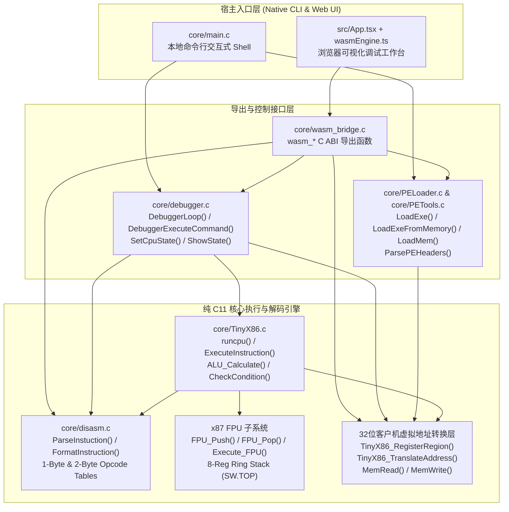

# TinyX86 系统架构、C11→WebAssembly 桥接机制与能力边界详解

本文档深入剖析 **TinyX86** 的内部模块化架构、取指-解码-执行（Fetch-Decode-Execute）主循环、32 位客户机虚拟地址转换层、WASI WebAssembly 直通桥接机制以及项目的能力边界。

---

## 1. 整体架构拓扑图



---

## 2. 核心数据结构剖析

### 2.1 `CPU_Context`（定义于 `include/TinyX86.h`）

`CPU_Context` 是整个模拟器的核心状态容器（在 32 位 / WASM32 下 `sizeof(CPU_Context) == 168` 字节）：
- **`REG32 GPR[8]`**：按 Intel 硬件寄存器编号排列的 8 个 32 位通用寄存器（`0=EAX, 1=ECX, 2=EDX, 3=EBX, 4=ESP, 5=EBP, 6=ESI, 7=EDI`），同时也支持通过匿名 union 别名直接访问 `ctx->EAX.I32`、`ctx->EAX.I16`、`ctx->EAX.I8.L`。
- **`uint32_t EIP`**：32 位指令指针寄存器，始终保存下一条待取指的 32 位客户机虚拟地址（如 `0x00400000`）。
- **`EFLAGS` 位域结构体**：包含 `CF, PF, AF, ZF, SF, TF, IF, DF, OF, IOPL(2-bit), NT` 等全部核心标志位。
- **`uint16_t seg[6]`**：6 个 16 位段选择子寄存器（`ES, CS, SS, DS, FS, GS`）。
- **`FPU_Context FPU`**：
  - `double Regs[8]`：8 个物理浮点寄存器 `R0 ~ R7`；
  - `FPU_StatusWord SW`：16 位状态字，包含条件码 `C0, C1, C2, C3` 与 3-bit 栈顶指针 `TOP`（`0~7`）；
  - `FPU_ControlWord CW`：16 位控制字（默认初始化为 `0x037F`，双精度、就近偶舍入、屏蔽全部浮点异常）。
- **`int Halted`**：停机状态标志（遇到 `HLT` 指令、`INT 21h / AH=4Ch` 或未映射内存访问异常时置 `1`）。

### 2.2 `DecodeContext`（定义于 `include/compat/disasm.h`）

每条指令在执行前，都会先经过 `ParseInstuction(uint8_t* code_ptr, uint32_t eip, DecodeContext* ctx)` 解码，填充以下关键字段：
- **前缀标志**：`pfx_rep` (`0xF3`), `pfx_repne` (`0xF2`), `pfx_op_size` (`0x66`), `pfx_addr_size` (`0x67`), `pfx_seg`。
- **操作码信息**：`is_two_byte_opcode`（是否以 `0x0F` 开头）、`opcode`、`entry`（指向 `OpcodeEntry` 表项，包含助记符与最多 3 个操作数的类型 `OperandType`）。
- **寻址字段**：`has_modrm`、`modrm`（拆解为 `mod`, `reg`, `rm`）、`has_sib`、`sib`（拆解为 `scale`, `index`, `base`）、位移 `disp`（`disp_len` 为 1/2/4 字节）、立即数 `imm` 与 `imm2`。
- **指令总长与反汇编文本**：`instr_len`（1~15 字节）与 `asm_str`（由 `FormatInstruction` 生成的标准 Intel 语法字符串）。

---

## 3. 单步取指-解码-执行主循环 (`runcpu`)

`core/TinyX86.c` 中的 `runcpu(CPU_Context* ctx, int steps)` 严格遵循硬件 CPU 的流水线语义：

1. **取指与地址转换（Fetch）**：
   - 调用 `uint8_t* code_ptr = TinyX86_TranslateAddress(ctx->EIP)` 将 32 位客户机虚拟地址转换为宿主内存指针。
2. **指令解码（Decode）**：
   - 调用 `int len = ParseInstuction(code_ptr, ctx->EIP, &d_ctx)` 解析机器码流并计算指令字节长度 `len`。
   - 调用 `FormatInstruction(code_ptr, &d_ctx)` 生成人类可读的反汇编文本。
3. **语义执行与 EIP 更新（Execute & Retire）**：
   - 记录执行前的 `uint32_t old_eip = ctx->EIP`。
   - 调用 `ExecuteInstruction(ctx, &d_ctx, code_ptr)` 执行具体指令逻辑。
   - **关键分支判定**：
     - 如果指令没有修改 `ctx->EIP`（即 `ctx->EIP == old_eip`），说明是顺序执行指令，自动推进 `ctx->EIP += len`；
     - 如果指令修改了 `ctx->EIP`（如 `JMP`, `CALL`, `RET`, 条件成立的 `Jcc`, `LOOP`），则保留跳转后的目标 `ctx->EIP`（哪怕自跳转 `jmp $` 即 `EB FE` 目标地址恰好等于 `old_eip`，也由 `is_branch` 标志位精确识别，不会误加 `len`）。

---

## 4. 跨平台 32 位虚拟地址转换层 (`TinyX86_TranslateAddress`)

早期版本仅能在 32 位 Windows（`Win32`）下运行，因为它直接使用 `VirtualAlloc((LPVOID)0x00400000, ...)` 并将 32 位寄存器值强转为宿主指针 `(uint8_t*)addr`。

为了在不牺牲 32 位 x86 真实虚拟地址体验的前提下支持 **64 位 Windows、Linux (x86_64/ARM64)、macOS (Intel/Apple Silicon) 与 WebAssembly**：
- `core/TinyX86.c` 维护了 `g_MemRegions[TINYX86_MAX_MEM_REGIONS]` 虚拟内存区间表：
  ```c
  typedef struct {
      uint32_t guest_base;
      uint32_t size;
      uint8_t* host_ptr;
      int      in_use;
  } GuestMemRegion;
  ```
- 加载器（`core/PELoader.c`）在加载程序时注册两个核心区域：
  1. **映像区（Image Region）**：默认客户机基址 `0x00400000`（或 PE 头的 `ImageBase`），指向宿主 `calloc` 分配的镜像缓冲区；
  2. **硬件栈区（Stack Region）**：固定客户机基址 `0x00100000`（大小 64KB，`0x10000` 字节），初始栈顶 `ESP = EBP = 0x0010FFE0`。
- 当 CPU 执行 `MemRead(addr, len)`、`MemWrite(addr, val, len)` 或取指时，`TinyX86_TranslateAddress(addr)` 在常数时间内定位所属区间并返回 `region->host_ptr + (addr - region->guest_base)`；若访问未映射地址，则打印 `[Memory Fault]` 并指向安全零页，彻底杜绝宿主进程崩溃。

---

## 5. 原生 C11 直通 WebAssembly (`public/tinyx86.wasm`) 桥接机制

为了确保用户在 Web 端调试时运行的 **100% 是仓库中的 C 语言代码**，项目设计了极简、透明的 WASI WebAssembly 桥接架构：

1. **零修改复用核心 C 文件**：
   - `core/TinyX86.c`、`core/disasm.c`、`core/PELoader.c`、`core/PETools.c`、`core/debugger.c` 同时参与本地 CMake/Make 编译与 WASI Clang 编译。
2. **`core/wasm_bridge.c` C ABI 导出层**：
   - 使用 `__attribute__((export_name("...")))` 导出 `wasm_load_preset`、`wasm_load_pe`、`wasm_load_bin`、`wasm_exec_command`、`wasm_disasm_at`、`wasm_get_gpr`、`wasm_set_cpu_state`、`wasm_mem_read` 等纯 C 函数。
3. **WASI `fd_write` 标准输出流实时拦截（`src/emulator/wasmEngine.ts`）**：
   - C 代码中所有的 `printf(...)`（例如 `core/debugger.c` 中的 `ShowState` 寄存器表格、`StepOver` 提示、`core/PELoader.c` 中的节区映射日志、`core/TinyX86.c` 中的 `DOS INT 21h` 输出）在经过 WASI `libc` 缓冲刷新（`fflush(stdout)`）后，会触发底层的 `wasi_snapshot_preview1.fd_write(fd=1, iovs, ...)` 系统调用。
   - `wasmEngine.ts` 在 `fd_write` 中直接从 WebAssembly 线性内存解码 UTF-8 字节流并追加到前端终端面板，实现了 **C 语言 `printf` 到浏览器终端的零损直通**。

---

## 6. 项目实际能力边界与局限性总结

1. **PE 加载器（`core/PELoader.c`）**：
   - ✅ 支持读取 DOS/NT 头、按节表 `VirtualAddress` 与 `PointerToRawData` 将各节拉伸映射到虚拟内存、分配 64KB 独立栈并将 `EIP` 设置为 `ImageBase + AddressOfEntryPoint`。
   - ❌ **不含导入表（IAT）解析、导出表（EAT）解析、基址重定位表（`.reloc`）修复及 TLS 回调执行**。
2. **系统调用与运行库环境**：
   - ✅ 支持 `INT 3` (`0xCC`) 软断点与极简 `DOS INT 21h`（`AH=02h/09h/4Ch`）高层模拟。
   - ❌ **不支持 Windows Win32 API（如 `kernel32.dll`、`msvcrt.dll`）或 Linux/macOS 系统调用**；因此不能直接运行包含标准 C 运行库启动代码（CRT）的常规 `.exe`，仅适用于无外部依赖的纯算法 PE32 程序或原始机器码（`.bin`）。
3. **指令集范围**：
   - ✅ 覆盖 32 位保护模式平坦内存模型下的用户态通用指令与 x87 FPU 核心浮点指令。
   - ❌ **不含 Ring 0 特权指令、GDT/LDT 段权限检查、页表（MMU）保护以及 MMX/SSE/AVX 向量指令集**。
