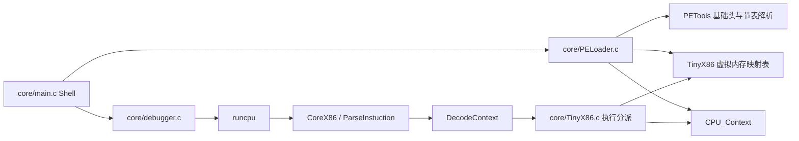

# TinyX86 架构、执行路径与项目能力边界

`core/main.c` 解析命令并调用加载器，加载后进入交互调试器。`core/PELoader.c` 负责简易 PE32 节区拉伸 / BIN / 内存数组映射与上下文初始化；`include/TinyX86.h` 定义通用寄存器、EIP、EFLAGS、段寄存器、FPU 状态和停机标志。

`runcpu(ctx, steps)` 每步先通过 `TinyX86_TranslateAddress(ctx->EIP)` 将 32 位客户机虚拟地址转换为宿主内存指针，再调用 `ParseInstuction` 解码、格式化、执行，并根据是否发生跳转更新 `EIP`；失败返回 `-1`，正常路径返回 `0`。

核心执行包含数据传送、ALU、栈、分支、字符串和 x87 浮点指令。x87 用八个 `double` 寄存器与 `SW.TOP` 模拟环形栈。

## 跨平台内存模型（Windows / Linux / macOS, 32-bit & 64-bit）

早期版本直接将 32 位 `EIP`、`ESP` 强转为宿主指针，仅能在 32 位 Windows（`Win32`）下运行。
当前版本在 `core/TinyX86.c` 中引入了轻量级 **32 位客户机虚拟内存映射表（`TinyX86_RegisterRegion` / `TinyX86_TranslateAddress`）**：
- 在 32 位 Windows 下可继续使用 `VirtualAlloc` 直接映射；
- 在 64 位 Windows、Linux（x86_64 / ARM64）和 macOS（Intel / Apple Silicon）下，加载器将代码段（如 `0x00400000`）与 64KB 栈段（`0x00100000`）注册到映射表中，所有访存（`MemRead` / `MemWrite`、`PUSH` / `POP`、`CALL` / `RET`、取指与调试器栈回溯）均通过地址转换层安全访问宿主内存。

## 项目实际能力边界与局限性

1. **PE 加载器（`PELoader.c`）仅支持基础入口点映射**：
   - 仅实现了读取 DOS/NT 头、按节表 `VirtualAddress` 与 `PointerToRawData` 拷贝各节数据、分配 64KB 独立栈并将 `EIP` 设置为 `ImageBase + AddressOfEntryPoint`。
   - **未实现导入表（IAT）解析、导出表（EAT）解析、基址重定位表（`.reloc`）修复及 TLS 回调**。
2. **无操作系统 API 与动态链接库环境**：
   - **不支持 Windows Win32 API（如 `kernel32.dll`、`msvcrt.dll`）或真实操作系统内核 Syscall**；仅在 `INT 21h` 中内置了极简的字符/字符串打印（`AH=02h/09h`）与停机退出（`AH=4Ch`）模拟。
   - 因此，不能直接运行带有标准 C 运行时（CRT 启动函数）或调用外部 DLL API 的常规 `.exe`，仅适用于无外部依赖的纯算法 PE32 程序或原始机器码（`.bin`）。
3. **指令集范围**：
   - 专注于 32 位保护模式平坦内存模型下的用户态通用指令与 x87 FPU 核心指令教学模拟；**不包含** Ring 0 特权指令、GDT/LDT 段权限校验、页表（MMU）保护以及 MMX/SSE/AVX 向量指令集。

## 依赖边界与自动回退

- 在 32 位 Windows 且已拉取 `deps/` 子模块时，CMake 可直接引用 `deps/Core-x86-Disassembler` 与 `deps/PETools`。
- 在 Linux、macOS、64 位构建或未拉取子模块的独立环境中，CMake 与 Makefile 自动使用仓库内置的跨平台 `core/disasm.c` 与 `core/PETools.c`，保证全平台开箱即用。
