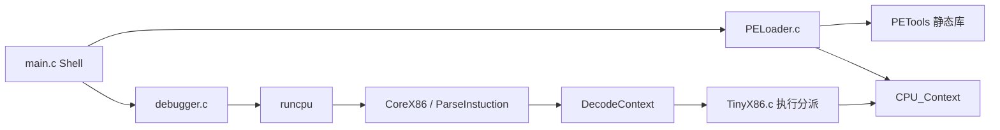

# TinyX86 架构与执行路径

`main.c` 解析命令并调用加载器，加载后进入交互调试器。`PELoader.c` 负责 PE/BIN/内存数组映射与上下文初始化；PE 头、节和布局功能来自 PETools。`TinyX86.h` 定义通用寄存器、EIP、EFLAGS、段寄存器、FPU 状态和停机标志。

`runcpu(ctx, steps)` 每步先调用共享库的 `ParseInstuction`，再格式化、执行，并根据是否跳转更新 EIP；失败返回 -1，正常路径返回 0。执行分派、寄存器与操作数辅助函数目前大多是实现文件内的 static 函数，正式公共入口以头文件为准。

核心执行包含数据传送、ALU、栈、分支、字符串和部分 x87 指令。x87 用八个 double 寄存器与 TOP 模拟栈；不能把它当作完整的 80 位精度和异常语义实现。

## 内存模型

EIP、ESP 和访存使用宿主进程中的 32 位地址，没有独立的访存总线或地址空间。这是当前要求 Win32/x86 构建的根本原因。加载器使用 VirtualAlloc 并设置初始 EIP/ESP；UnloadExe 释放映射。PE 只按当前教学范围处理，不提供 Windows 进程环境或通用导入 API 执行能力。

## 依赖边界

TinyX86 不再编译应用根目录中的 disasm.c/PETools.c。原生工程引用 `deps/Core-x86-Disassembler/CoreX86.vcxproj` 与 `deps/PETools/PETools.vcxproj`。CMake 对应目标是 `core_x86` 和 `petools`，CPU 执行器单独构建为 `tinyx86_cpu`，便于集成测试。

子模块的 commit 由父仓库锁定；更新共享库后必须重新验证 CPU 与解码器的结构布局、长度字段和指令行为。新增测试直接使用真实库，可发现只更新头文件、忘记更新实现等集成问题。
