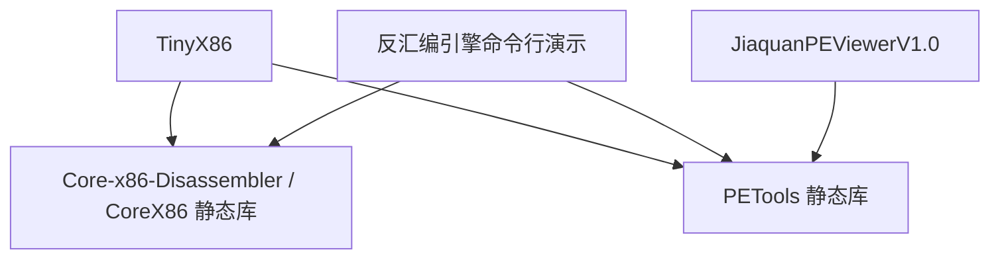

# 项目关系与共享代码管理

这些项目来自滴水逆向学习练习。每个应用独立发布；共享库保留独立 Git 历史，通过 Git 子模块固定依赖提交，通过 Visual Studio `ProjectReference` 或 CMake 静态库目标编译链接。

| 仓库 | 职责 |
| --- | --- |
| [TinyX86](https://github.com/582835293/TinyX86) | CPU 模拟器、加载器与交互调试器 |
| [Core-x86-Disassembler](https://github.com/582835293/Core-x86-Disassembler) | x86 指令解码静态库与命令行演示 |
| [PETools](https://github.com/582835293/PETools) | PE32 解析和编辑静态库 |
| [JiaquanPEViewerV1.0](https://github.com/582835293/JiaquanPEViewerV1.0) | Win32 API 图形界面练习与 PE 查看器 |



解码核心只依赖 C 标准库，独立于 PETools 和执行器。反汇编仓库中的 PE 演示依赖 PETools。TinyX86 子模块里出现的嵌套 PETools 是演示程序自己的依赖；TinyX86 只链接顶层 PETools 一次。

## 三种关系各管什么

- Git 仓库：决定代码在哪里维护、提交和发布。
- Git 子模块：在应用的 `deps/` 中保存库仓库，并在父仓库里记录准确的提交号；GitHub 中可以点击进入对应库和版本。
- Visual Studio 项目引用：决定先构建哪个 `.lib`、应用如何链接；头文件搜索目录在 `.vcxproj` 中配置。

解决方案 `.slnx` 负责组织项目，本身不会建立 Git 仓库之间的依赖。

## 第一次下载

```powershell
git clone --recurse-submodules https://github.com/582835293/TinyX86.git
cd TinyX86
```

如果已经下载但 `deps/` 为空：

```powershell
git submodule sync --recursive
git submodule update --init --recursive
```

GitHub 的 Download ZIP 不包含子模块代码；构建请用 Git 递归克隆。

## 平时怎么修改共享库

每个共享库只有一个上游仓库。不同应用里的子模块是该仓库的独立检出，不会在磁盘上自动同步。不要再把 `.c/.h` 手工复制回应用根目录。

例如直接在 TinyX86 的 PETools 子模块修复问题：

```powershell
git -C deps/PETools switch -c fix/pe-header
# 编辑 deps/PETools 中的代码，编译、测试
git -C deps/PETools add PETools.c PETools.h
git -C deps/PETools commit -m "fix: correct PE header parsing"
git -C deps/PETools push -u origin fix/pe-header
# 在 GitHub 审阅并合入 PETools/main 后，回到应用根目录
git -C deps/PETools fetch origin
git -C deps/PETools checkout origin/main
git add deps/PETools
git commit -m "chore: update PETools"
git push
```

也可以在原始 PETools 目录开发并推送，再在各应用里执行最后的 fetch、checkout、测试和提交步骤。必须先推送库提交，再推送引用它的应用；否则别人无法下载依赖。

子模块通常处于 detached HEAD，这是按提交锁定依赖的正常状态；编辑前创建分支。父仓库的 `git add deps/PETools` 只记录库的提交号，不会替你提交库内文件。

## 拉取与升级的区别

```powershell
# 获取应用已验证的依赖版本
git pull --ff-only
git submodule update --init --recursive

# 查看当前依赖提交
git submodule status --recursive

# 有意升级到 PETools 的最新主分支（升级后必须重新构建和测试）
git -C deps/PETools fetch origin
git -C deps/PETools checkout origin/main
git add deps/PETools
git commit -m "chore: update PETools dependency"
git push
```

不要把 `git submodule update --remote` 当作普通同步命令，它可能改变已锁定的版本。

## 构建环境

当前完整应用和 PETools 支持 Windows x86/PE32；使用 Visual Studio 的 x86（MSBuild 名称 `Win32`）配置。代码中仍有指针与 `DWORD`/`uint32_t` 转换，不能把选择 x64 配置当作完成了 64 位移植。解码结构里的 `mode64` 也不代表完整支持 x86-64。

原生项目默认使用本机已有的 v145 工具集、Windows 10 SDK；安装了 v143 的 Visual Studio 2022 可用命令行 `/p:PlatformToolset=v143` 覆盖。CMake 通过所选生成器选工具集。PEViewer 的当前可复现配置统一为现代工具集；原来混用的 XP Release 配置需作为后续单独兼容工作处理。

## 迁移记录

- 保留 TinyX86 和解码器的已有 Git 历史，以及迁移前 TinyX86 的未提交代码内容。
- 将 TinyX86 的 `instr_len` 字段与赋值、ENTER 指令组表修正合回解码器；保留原引擎的解析辅助函数接口。
- PETools 使用原始 `初级班/PE/PETools` 的完整实现；与 TinyX86 副本有效代码一致，包含 PEViewer 所用的字符串输出接口。
- PETools 头文件的 `tempBuf` 改为 `extern`，由源文件提供唯一定义，支持 C/C++ 跨编译单元链接；统一 Unicode 与 UTF-8 构建。
- 从应用中移除六个共享源码副本，以子模块和静态库引用取代。
- PEViewer 的图标纳入 `assets/`；缺失的小图标暂复用现有主图标，去除桌面绝对路径。
- 新增 CMake、Windows CI 和真实共享解码器的 CPU 集成测试；原 Google Test 工程仍保留。

参考：[Git 官方子模块文档](https://git-scm.com/book/en/v2/Git-Tools-Submodules)、[Microsoft C++ 项目结构](https://learn.microsoft.com/en-us/cpp/build/reference/vcxproj-file-structure)。
